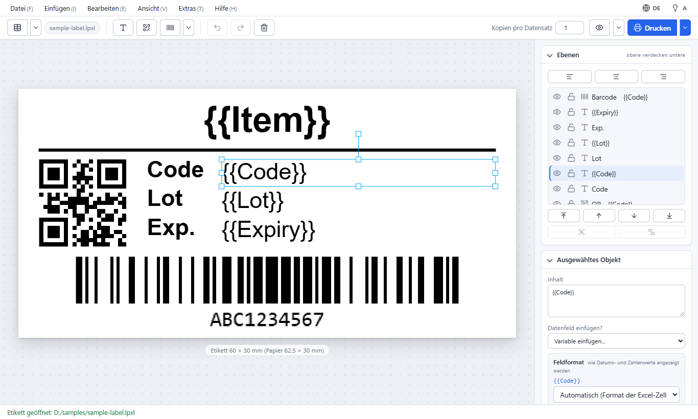
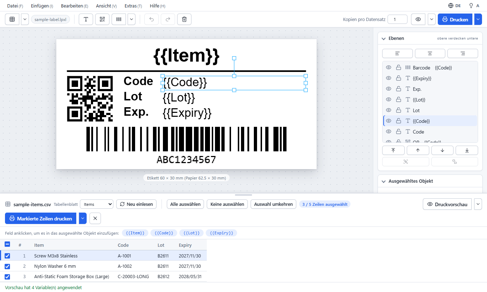
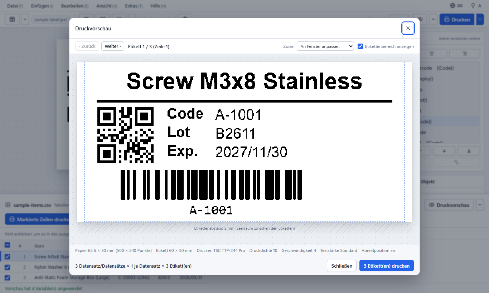
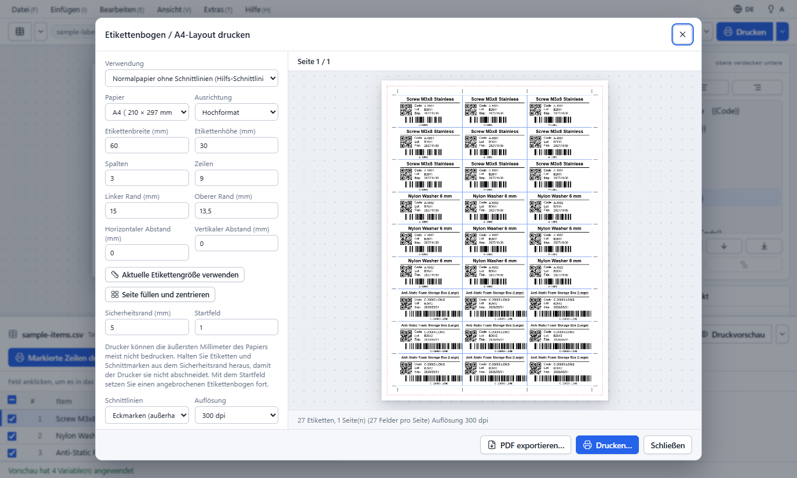
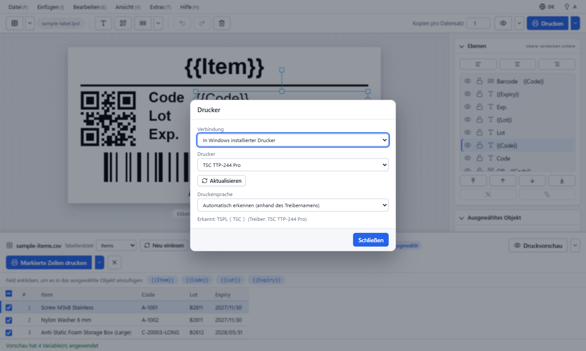

# Label Printer

[繁體中文](README.md) · [English](README.en.md) · [简体中文](README.zh-CN.md) · [Español](README.es.md) · **Deutsch** · [日本語](README.ja.md) · [한국어](README.ko.md)

<p align="center"></p>

Quelloffenes, kostenloses, schlankes Programm zum Gestalten und Drucken von Etiketten für Windows. Etikett entwerfen, eine Datenquelle verbinden (Excel, CSV, SQLite, Access oder jede per ODBC erreichbare Datenbank) und Hunderte unterschiedlicher Etiketten in einem Durchgang drucken. Geeignet für Etikettendrucker, die TSPL, ZPL, EPL2, CPCL, DPL oder SBPL verwenden, zum Beispiel den TSC TTP-244 Pro (alles außer TSPL ist experimentell).

**Windows 10/11 · Open Source (MIT) · Völlig kostenlos · Installer ca. 5 MB**

## Warum Label Printer

<table>
<tr>
<td valign="top" width="50%"><b>Leicht und sofort einsatzbereit</b><br>Der Installer ist nur etwa 5 MB groß. Kein Datenbankserver, kein Konto, keine Internetverbindung und keine komplizierte Designsoftware, die man erst lernen müsste.</td>
<td valign="top" width="50%"><b>Gestaltung, Daten und Druck in einem Fenster</b><br>Etikett gestalten, eine Excel-Datei oder Datenbank wählen, die zu druckenden Zeilen ankreuzen und auf Drucken klicken. Wer Word und Excel kennt, ist in wenigen Minuten produktiv.</td>
</tr>
<tr>
<td valign="top" width="50%"><b>Wirklich kostenlos und offen</b><br>Der Quellcode steht unter der MIT-Lizenz. Keine Werbung, keine Lizenzschlüssel, keine Begrenzung der Etikettenzahl, und Ihre Etiketten werden nirgendwohin hochgeladen.</td>
<td valign="top" width="50%"><b>Passt zu gängigen Etikettendruckern</b><br>TSC (TSPL) ist der Hauptweg; außerdem werden ZPL, EPL2, CPCL, DPL und SBPL unterstützt (alles außer TSPL ist experimentell); ein normaler Drucker kann auf das A4-Aufkleberbogen-Layout umschalten.</td>
</tr>
</table>

## Das können Sie damit tun

-  **Etiketten visuell gestalten**: Text, QR-Codes, Barcodes, Linien, Rechtecke und Bilder. Ziehen, Größe ändern, ausrichten, gruppieren und rückgängig machen.
-  **Aus Excel oder CSV drucken**: Setzen Sie `{{Item}}`, `{{Lot}}` … auf das Etikett. Jede markierte Zeile wird zu einem Etikett.
-  **Vor dem Drucken prüfen**: Die Druckvorschau zeigt genau das Schwarzweißbild, das an den Drucker gesendet wird – Etikett für Etikett.
-  **Lange Texte passen sich an**: Legen Sie einen festen Bereich fest; ist ein Name zu lang, wird die Schriftgröße automatisch verkleinert.
-  **Ausdruck feinjustieren**: Druckdichte, Geschwindigkeit, Abreißposition und ein Kalibrierungsetikett mit Lineal, um die Position auf den Millimeter zu korrigieren.
-  **Sieben Sprachen**: English, Español, Deutsch, 日本語, 한국어, 简体中文 und 繁體中文, wahlweise in heller oder dunkler Darstellung.

## Geeignet für

- **Lager und Versand**: Seriennummern, Chargen und Verfallsdaten: eine ganze Charge verschiedener Etiketten in einem Durchgang drucken.
- **Geräte- und Anlagenverwaltung**: Ein Etikett pro Gerät mit Nummer und QR-Code; ein Scan führt direkt zum Datensatz.
- **Labore und Produktionslinien**: Barcode-Etiketten für Röhrchen, Material und Halbfertigteile, mit Feldern direkt aus Ihrer vorhandenen Excel-Datei oder Datenbank.
- **A4-Aufkleberbögen und Briefumschlag-Streifen**: Etiketten in Spalten und Zeilen auf A4 anordnen, bei Bedarf Schnitthilfslinien drucken und den vom Drucker nicht erreichbaren Rand freihalten.

## Screenshots

<sub>Klicken Sie auf eine Vorschau, um sie in voller Größe zu sehen.</sub>

<table>
<tr>
<td align="center" width="50%"><a href="docs/images/de/data.png"></a><br><sub>Eine Datenquelle (Excel oder CSV) wählen und die zu druckenden Zeilen markieren. Ein Klick auf einen Feldnamen fügt ihn in das ausgewählte Objekt ein.</sub></td>
<td align="center" width="50%"><a href="docs/images/de/preview.png"></a><br><sub>Die Druckvorschau zeigt jedes Etikett so, wie der Drucker es druckt.</sub></td>
</tr>
<tr>
<td align="center" width="50%"><a href="docs/images/de/sheet.png"></a><br><sub>Etikettenbogen / A4-Layout: Papier, Spalten und Zeilen, Ränder und Schnittlinien festlegen. Rechts sehen Sie die Seitenvorschau (die rote gestrichelte Linie ist der Sicherheitsrand).</sub></td>
<td align="center" width="50%"><a href="docs/images/de/printer.png"></a><br><sub>Wählen Sie in den Druckereinstellungen die Verbindung und die Druckersprache. Bei einem Windows-Drucker wird die Sprache anhand des Treibers erkannt.</sub></td>
</tr>
</table>

## Download und Installation

Öffnen Sie die [Releases-Seite](https://github.com/mixneko/Label-Printer/releases/latest) und laden Sie eine dieser Dateien herunter:
- **`…_x64-setup.exe`** (empfohlen): Installationsprogramm. Es installiert für den aktuellen Benutzer und braucht keine Administratorrechte. Ein Doppelklick auf eine `.lpxl`-Etikettendatei öffnet sie in der App, und die App kann sich selbst aktualisieren.
- **`…_x64-portable.exe`**: ohne Installation; an einen beliebigen Ort kopieren und starten. Sie kann sich nicht selbst aktualisieren (stattdessen wird die Download-Seite geöffnet).

Voraussetzung ist 64-Bit-Windows 10 oder 11. Das Installationsprogramm fügt die Komponente WebView2 hinzu, falls Ihr PC sie noch nicht hat.

>  Das Programm ist noch nicht code-signiert. Deshalb zeigt Windows beim ersten Start eventuell den blauen Hinweis „Der Computer wurde durch Windows geschützt“. Klicken Sie auf **Weitere Informationen → Trotzdem ausführen**.

## Schnellstart

1. **Drucker wählen.** Beim ersten Start fragt das Fenster „Ersteinrichtung“, auf welchem Drucker die Etiketten gedruckt werden (das Programm wählt nicht für Sie aus, damit Etiketten nicht versehentlich auf einem Bürodrucker landen). Später ändern Sie das unter **Extras → Drucker…**. Wählen Sie einen normalen Drucker (Bürodrucker, PDF), wechseln **Drucken** und **Druckvorschau** direkt zum A4-/Etikettenbogen-Layout.
2. **Papier einstellen.** Öffnen Sie **Extras → Papier- und Etikettengröße…** und geben Sie die Papier- und Etikettengröße in Millimetern ein.
3. **Etikett gestalten.** Fügen Sie über das Menü **Einfügen** oder die Symbolleiste Text, QR-Codes, Barcodes usw. hinzu und ziehen Sie sie an die gewünschte Stelle. Um Daten aus einer Liste zu verwenden, geben Sie im Text `{{Item}}` ein (ein Spaltenname in doppelten geschweiften Klammern).
4. **Datenquelle wählen.** Klicken Sie auf **Datenquelle wählen** und wählen Sie eine Excel- oder CSV-Datei. Die erste Zeile enthält die Spaltennamen; jede weitere Zeile ist ein Datensatz.
5. **Markieren, ansehen, drucken.** Markieren Sie die benötigten Zeilen, prüfen Sie sie mit **Druckvorschau** und klicken Sie auf **Drucken**. Mit **Kopien pro Datensatz** legen Sie fest, wie oft jede Zeile gedruckt wird.

## Nützliche Tipps

- **Datum und Zahlen sehen aus wie in Excel.** Eine Zelle im Format `yyyy/mm/dd` wird so gedruckt. Ein anderes Format wählen Sie mit `{{Expiry|yyyy-mm-dd}}`.
- **Zu lange Namen.** Wählen Sie das Textobjekt, aktivieren Sie **Auf festen Bereich begrenzen (Maximalbereich)** und dann **Schriftgröße automatisch verkleinern**. Der Text wird nur dann kleiner, wenn es nötig ist.
- **Mehrere Objekte auswählen.** Strg oder Umschalt gedrückt halten und klicken, oder einen Rahmen um die Objekte ziehen. Strg+G gruppiert, Strg+Umschalt+G löst die Gruppe auf.
- **Ausrichtungshilfen.** Beim Ziehen erscheinen rosa Hilfslinien; mit gedrückter Alt-Taste bewegen Sie frei.
- **Tastenkürzel.** Strg+S speichern · Strg+P Druckvorschau · Strg+Z rückgängig · Strg+Y wiederholen · Strg+A alles auswählen.
- **Darstellung und Sprache.** Die Glühbirne wechselt zwischen automatisch, hell und dunkel; der Globus ändert die Sprache.

## Ausdruck zu hell oder verschoben?

- **Zu hell:** Erhöhen Sie zuerst die **Druckdichte** (die Vorschau ändert sich nicht, der Ausdruck wird aber dunkler) und verringern Sie dann die Geschwindigkeit. Wirken dünne Striche schwach, erhöhen Sie **Textstärke**; die Vorschau zeigt die Wirkung sofort.
- **Verschoben:** Öffnen Sie **Extras → Druckqualität und Papiervorschub…**, klicken Sie auf **Kalibrierungsetikett erstellen** und drucken Sie eines. Prüfen Sie, ob alle vier Rahmenseiten vollständig sind, und lesen Sie die Verschiebung an den Millimeter-Strichen ab (0 ist der Papierrand). Tragen Sie die Korrektur dann bei **Horizontale Verschiebung (mm)** und **Vertikale Verschiebung (mm)** ein. Liegt der Ausdruck zu weit links, geben Sie einen positiven horizontalen Wert ein; liegt er zu hoch, einen positiven vertikalen Wert.

## Automatische Updates

Die installierte Version fragt beim Start einmal im Hintergrund bei GitHub nach. Dabei werden nur die öffentlichen Versionsinformationen gelesen; Ihre Daten werden nicht gesendet. Gibt es eine neue Version, erscheint ein Fenster mit **Jetzt aktualisieren**: Das Update wird in der App heruntergeladen, die Signatur geprüft, installiert, und die App startet neu. Die Prüfung beim Start schalten Sie unter **Hilfe → Beim Start nach Updates suchen** aus; manuell prüfen Sie jederzeit mit **Hilfe → Nach Updates suchen**.

## Beispieldateien

Der Ordner `samples/` enthält ein sofort nutzbares Beispiel: `sample-label.lpxl` (ein Produktetikett von 60×30 mm mit QR-Code, Barcode und Datum) mit passenden Daten in `sample-items.csv` und `sample-items.xlsx` (Spalten Item, Code, Lot, Expiry). Öffnen Sie das Etikett und wählen Sie dann eine der Datendateien. `sample-items-big5.csv` ist dieselbe Liste in der Big5-Kodierung, die Excel in Taiwan beim Speichern als CSV verwendet; das Programm erkennt UTF-8 und Big5 automatisch.

## Mit einer Datenbank verbinden (SQLite, Access, ODBC)

Neben Excel und CSV kann auch eine Datenbank die Datenquelle sein: Klicken Sie auf **das ▾ neben Datenquelle wählen → Mit Datenbank verbinden…** oder wählen Sie unter „Datenquelle wählen“ direkt eine SQLite- oder Access-Datei (`.db`, `.sqlite`, `.mdb`, `.accdb`). Nach dem Laden funktioniert alles wie bei Excel: Zeilen markieren, Vorschau, Drucken, und die Tabelle lässt sich in der Auswahlliste wechseln.

- **SQLite**: einfach die Datei wählen. Mit echten SQLite-Dateien getestet.
- **Access**: Auf dem PC wird der „Microsoft Access Driver (*.mdb, *.accdb)“ benötigt (wird mit Microsoft Office oder der kostenlosen Access Database Engine installiert; er muss dieselbe Bit-Version wie dieses Programm haben, also 64 Bit). Noch nicht mit einer echten Access-Datei geprüft, daher als experimentell gekennzeichnet.
- **SQL Server, MySQL/MariaDB, PostgreSQL**: Die Verbindung ist eingebaut, es muss **kein Treiber installiert werden**. Datenbanktyp im Dialog wählen und Server, Datenbankname und Zugangsdaten eintragen (SQL Server kann auch die Windows-Authentifizierung nutzen); eine Verbindungszeichenfolge ist nicht nötig. Verbindungen werden standardmäßig verschlüsselt und das Serverzertifikat wird geprüft; bei einem selbstsignierten Zertifikat im internen Netz ändern Sie „Verbindungssicherheit“, um ihm zu vertrauen. Empfohlen wird ein Konto mit reiner Leseberechtigung. MySQL/MariaDB und PostgreSQL wurden mit MariaDB 11.8 und PostgreSQL 18 getestet (auch verschlüsselte Verbindungen); SQL Server wurde noch nicht mit einem echten Server geprüft und ist daher als experimentell gekennzeichnet. Andere Datenbanken und Access nutzen weiterhin ODBC und brauchen ihren installierten Treiber („Anderes ODBC“ wählen und eine Verbindungszeichenfolge eingeben).
- Immer **schreibgeschützt**; die Datenbank wird nie verändert, und ein Passwort in der Verbindungszeichenfolge bleibt nur im Arbeitsspeicher und wird nie gespeichert. Mit einer SELECT-Abfrage können Sie nur benötigte Spalten übernehmen oder Zeilen filtern. Datums- und Zahlenspalten funktionieren auch mit Formaten wie `{{Feld|yyyy/mm/dd}}`. Es werden höchstens 100.000 Zeilen auf einmal gelesen; bei größeren Daten grenzen Sie sie per Abfrage ein.

## Weitere Etikettendrucker und A4-Etikettenbögen (experimentell)

Die beiden folgenden Funktionen sind fertig programmiert und bestehen die automatischen Tests, wurden aber **noch nicht an echten Druckern geprüft** und sind deshalb als experimentell gekennzeichnet. Wenn Sie sie ausprobieren, freuen wir uns über eine Rückmeldung.

**Weitere Druckersprachen.** Neben dem Standard TSPL (TSC) können Sie ZPL II, EPL2, CPCL, DPL (Datamax-O'Neil) und SBPL (SATO) wählen. Bei einem Windows-Drucker schließt das Programm anhand des Treibernamens auf die Sprache; gelingt das nicht (es rät nie für Sie) oder verbinden Sie per Raw TCP, wählen Sie die **Druckersprache** selbst (in der Ersteinrichtung oder unter **Extras → Drucker…**). Ist der Drucker kein Etikettendrucker (Bürodrucker, PDF usw.), wählen Sie „Normaler Drucker“ oder lassen Sie ihn erkennen; **Drucken** und **Druckvorschau** wechseln dann direkt zum A4-/Etikettenbogen-Layout. Standardmäßig senden diese Sprachen nur ein Bitmap. Kreuzen Sie in den Eigenschaften eines Barcodes oder QR-Codes „Mit nativen Druckerbefehlen drucken“ an, um stattdessen die eigenen Barcodebefehle des Druckers zu verwenden (dabei erscheint der Hinweis „Experimentell“ mit einem Kolben-Symbol; bitte melden Sie, wie der Ausdruck aussieht; EPL2 und SBPL haben keinen QR-Befehl, QR-Codes werden dort weiterhin als Bild gedruckt).

**Etikettenbögen und A4-Layout.** Mit **dem ▾ neben Drucken → Etikettenbogen / A4-Layout drucken…** (auch über das ▾ neben Druckvorschau; ist ein normaler Drucker gewählt, öffnet schon ein Klick auf Drucken oder Druckvorschau das Layout) ordnen Sie Etiketten in mehreren Spalten und Zeilen auf A4 oder Letter an:

- „Gestanzter Etikettenbogen“ druckt keine Schnittlinien; „Normalpapier ohne Schnittlinien“ kann Eckmarken oder gestrichelte Gitterlinien als Schneidehilfe drucken (zum Beispiel für Briefumschlag-Streifen).
- **Sicherheitsrand** (standardmäßig 5 mm): Drucker können den äußersten Papierrand meist nicht bedrucken. Etiketten oder Schnittmarken in diesem Bereich werden in der Vorschau rot markiert. „Seite füllen und zentrieren“ hält automatisch Abstand dazu.
- Mit dem **Startfeld** setzen Sie einen angebrochenen Etikettenbogen fort. Sie können ein PDF exportieren oder direkt über das Windows-Druckfenster drucken (Skalierung „100 % / Originalgröße“, Ränder „Keine“).

## Häufige Fragen

**Mein Drucker steht nicht in der Liste.**  
Installieren Sie den Drucker zuerst in Windows (Einstellungen → Drucker & Scanner). Öffnen Sie dann **Extras → Drucker…** und aktualisieren Sie die Liste.

**Auf einem anderen Computer sehen die Schriften anders aus.**  
Etiketten verwenden die in Windows installierten Schriften. Installieren Sie dieselben Schriften auf dem anderen Computer.

**Werden meine Daten irgendwohin gesendet?**  
Nein. Das Programm arbeitet offline. Der einzige Netzwerkzugriff ist die oben beschriebene Update-Prüfung, die nur bei GitHub nachfragt, ob es eine neuere Version gibt.

**Wo werden meine Etiketten gespeichert?**  
Dort, wo Sie es festlegen, als Dateien mit der Endung `.lpxl`.

## Lizenz

Veröffentlicht unter der [MIT-Lizenz](LICENSE). Die Lizenzen der verwendeten Drittanbieter-Pakete finden Sie in der App unter **Hilfe → Lizenzen von Drittanbietern**. Die Symbole der Oberfläche stammen von [Lucide](https://lucide.dev) (ISC-Lizenz).

<details>
<summary><b>Für Entwickler</b></summary>

Technik: Tauri 2 (Rust) + TypeScript + Vite + Konva. Das Etikett wird im Frontend gerendert; das Backend erzeugt die Befehle der gewählten Druckersprache (TSPL, ZPL, EPL2, CPCL, DPL oder SBPL) und sendet sie an den Drucker (Windows-Druckwarteschlange im RAW-Modus oder Raw TCP).

```powershell
npm install
npm run tauri dev        # Entwicklungsmodus
npm run tauri build      # portable exe + NSIS-Installer
npm run test:ui          # UI-Tests (benötigt Microsoft Edge)
cargo test --manifest-path src-tauri/Cargo.toml
```

Voraussetzungen: Node.js LTS, Rust (MSVC-Toolchain mit der Workload „Desktopentwicklung mit C++“) und WebView2.

Releases werden von GitHub Actions gebaut, sobald ein Tag `vX.Y.Z` gepusht wird. Der Workflow benötigt das Repository-Secret `TAURI_SIGNING_PRIVATE_KEY` (der mit `tauri signer generate` erzeugte private Schlüssel zum Signieren von Updates; der öffentliche Schlüssel steht in `src-tauri/tauri.conf.json`). Geht dieser Schlüssel verloren, lassen sich installierte Kopien nicht mehr aktualisieren.

xlsx/csv-Beispiele neu erzeugen: `cargo run --manifest-path src-tauri/Cargo.toml --example make_samples`. README-Screenshots neu erzeugen: `node scripts/make-readme-shots.mjs`.

</details>
