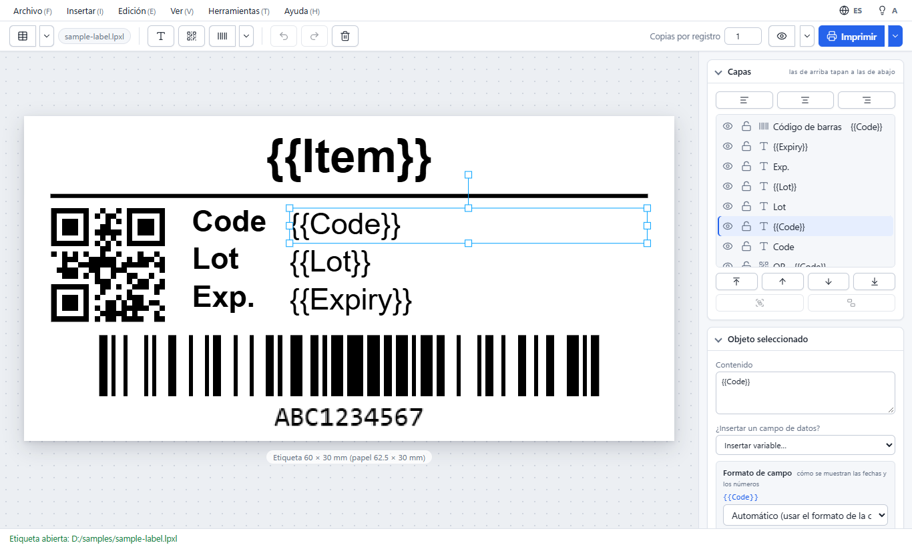
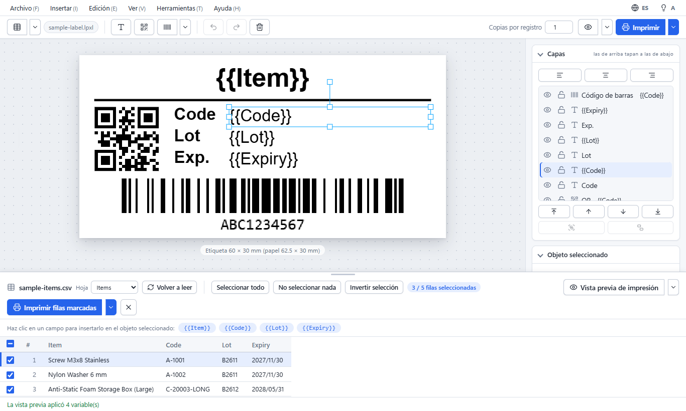
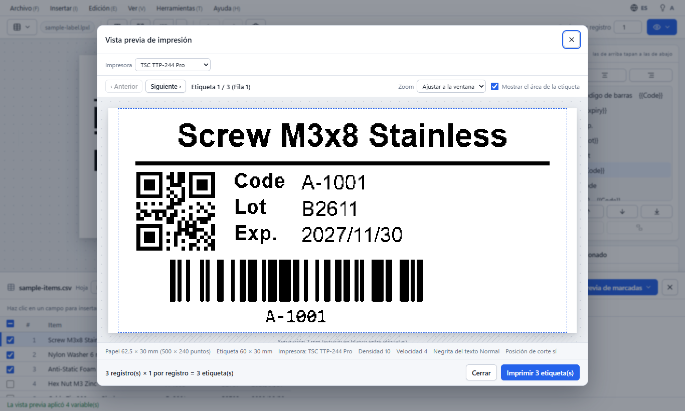
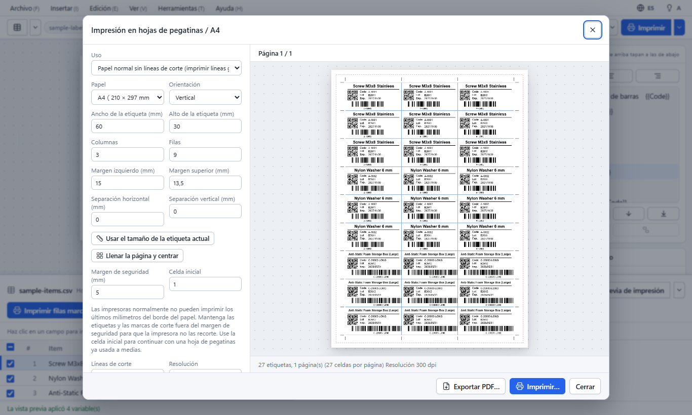
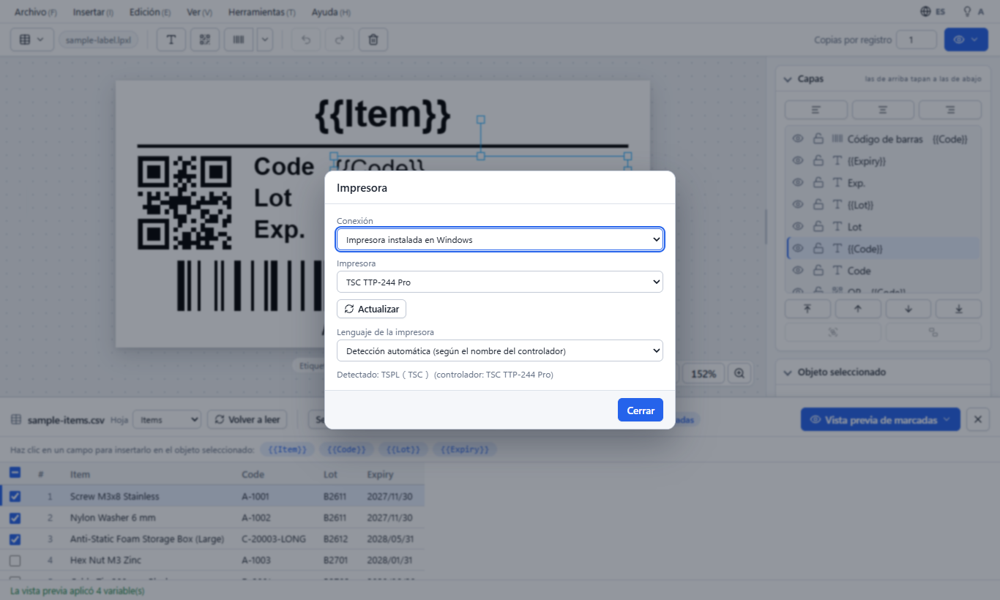

# Label Printer

[English](README.md) · [繁體中文](README.zh-TW.md) · [简体中文](README.zh-CN.md) · **Español** · [Deutsch](README.de.md) · [日本語](README.ja.md) · [한국어](README.ko.md)

<p align="center"></p>

Diseño e impresión de etiquetas para Windows, de código abierto, gratuito y ligero. Diseñe una etiqueta, conecte un origen de datos (Excel, CSV, SQLite, Access o cualquier base de datos accesible por ODBC) e imprima cientos de etiquetas distintas de una sola vez. Funciona con impresoras de etiquetas que usan TSPL, ZPL, EPL2, CPCL, DPL o SBPL, como la TSC TTP-244 Pro (todo lo que no sea TSPL es experimental).

**Windows 10/11 · Código abierto (MIT) · Totalmente gratuito · instalador de unos 5 MB**

## Por qué Label Printer

<table>
<tr>
<td valign="top" width="50%"><b>Ligero y listo para usar</b><br>El instalador pesa unos 5 MB. No necesita servidor de base de datos, ni registrar una cuenta, ni conexión a internet, ni aprender antes un programa de diseño complicado.</td>
<td valign="top" width="50%"><b>Diseño, datos e impresión en una sola ventana</b><br>Diseña una etiqueta, elige un archivo de Excel o una base de datos, marca las filas que quieres imprimir y pulsa Imprimir. Si sabes usar Word y Excel, en pocos minutos serás productivo.</td>
</tr>
<tr>
<td valign="top" width="50%"><b>Gratis y abierto de verdad</b><br>El código fuente se publica con licencia MIT. Sin anuncios, sin claves de licencia, sin límite de etiquetas, y tus etiquetas no se suben a ningún sitio.</td>
<td valign="top" width="50%"><b>Compatible con impresoras de etiquetas habituales</b><br>TSC (TSPL) es la vía principal; también se admiten ZPL, EPL2, CPCL, DPL y SBPL (todo lo que no sea TSPL es experimental); una impresora normal puede usar la disposición en hojas de pegatinas A4.</td>
</tr>
</table>

## Qué puede hacer

-  **Diseño visual de etiquetas**: Texto, códigos QR, códigos de barras, líneas, rectángulos e imágenes. Arrastre, redimensione, alinee, agrupe y deshaga.
-  **Impresión desde Excel o CSV**: Ponga `{{Item}}`, `{{Lot}}` … en la etiqueta. Cada fila que marque se convierte en una etiqueta.
-  **Compruébelo antes de imprimir**: La vista previa muestra exactamente la imagen en blanco y negro que se envía a la impresora, etiqueta por etiqueta.
-  **El texto largo se ajusta solo**: Defina un área fija y el tamaño de fuente se reduce automáticamente cuando un nombre es demasiado largo.
-  **Ajuste fino de la impresión**: Densidad, velocidad, posición de corte y una etiqueta de calibración con regla para corregir la posición al milímetro.
-  **Siete idiomas**: English, Español, Deutsch, 日本語, 한국어, 简体中文 y 繁體中文, con apariencia clara u oscura.

## Ideal para

- **Almacén y envíos**: Números de serie, lotes y fechas de caducidad: imprime de una vez un lote entero de etiquetas distintas.
- **Gestión de equipos y activos**: Una etiqueta por equipo con su número y un código QR; basta escanearla para consultar el registro.
- **Laboratorios y líneas de producción**: Etiquetas con código de barras para tubos, materiales y producto en curso, con campos tomados de tu Excel o base de datos.
- **Hojas de pegatinas A4 y tiras para sobres**: Coloca etiquetas en columnas y filas sobre A4, imprime líneas guía de corte si hace falta y evita el borde que la impresora no alcanza.

## Capturas de pantalla

<sub>Haga clic en una miniatura para verla a tamaño completo.</sub>

<table>
<tr>
<td align="center" width="50%"><a href="docs/images/es/data.png"></a><br><sub>Elija un origen de datos (Excel o CSV) y marque las filas que desea imprimir. Haga clic en el nombre de un campo para insertarlo en el objeto seleccionado.</sub></td>
<td align="center" width="50%"><a href="docs/images/es/preview.png"></a><br><sub>La vista previa muestra cada etiqueta tal como la imprimirá la impresora.</sub></td>
</tr>
<tr>
<td align="center" width="50%"><a href="docs/images/es/sheet.png"></a><br><sub>Impresión en hojas de pegatinas / A4: defina el papel, las columnas y filas, los márgenes y las líneas de corte. La vista previa de la página está a la derecha (la línea roja discontinua es el margen de seguridad).</sub></td>
<td align="center" width="50%"><a href="docs/images/es/printer.png"></a><br><sub>Elija la conexión y el lenguaje de la impresora en los ajustes de Impresora. Con una impresora de Windows, el lenguaje se detecta a partir del controlador.</sub></td>
</tr>
</table>

## Descarga e instalación

Abra la [página de Releases](https://github.com/mixneko/Label-Printer/releases/latest) y descargue uno de estos archivos:
- **`…_x64-setup.exe`** (recomendado): instalador. Se instala para el usuario actual y no necesita permisos de administrador. Al hacer doble clic en un archivo de etiqueta `.lpxl` se abre en la aplicación, y la aplicación puede actualizarse sola.
- **`…_x64-portable.exe`**: sin instalación; cópielo donde quiera y ejecútelo. No puede actualizarse en el propio programa (abre la página de descarga).

Requiere Windows 10 u 11 de 64 bits. El instalador añade el componente WebView2 si el equipo aún no lo tiene.

>  El programa todavía no tiene firma de código, así que la primera vez Windows puede mostrar un aviso azul «Windows protegió su PC». Haga clic en **Más información → Ejecutar de todas formas**.

## Primeros pasos

1. **Elija su impresora.** La primera vez que inicie el programa, una ventana de «Primera configuración» le pregunta en qué impresora imprimir las etiquetas (el programa no elige por usted, para que las etiquetas no vayan por error a una impresora de oficina). Para cambiarla después, abra **Herramientas → Impresora…**. Si elige una impresora normal (de oficina, PDF), **Imprimir** y **Vista previa de impresión** pasan directamente a la maquetación A4 / hojas de pegatinas.
2. **Defina el papel.** Abra **Herramientas → Tamaño del papel y de la etiqueta…** e introduzca el tamaño del papel y de la etiqueta en milímetros.
3. **Diseñe la etiqueta.** Use el menú **Insertar** o la barra de herramientas para añadir texto, códigos QR, códigos de barras, etc., y arrástrelos a su sitio. Para usar datos de una lista, escriba `{{Item}}` (el nombre de una columna entre dobles llaves) en el texto.
4. **Elija el origen de datos.** Haga clic en **Elegir origen de datos** y seleccione un archivo Excel o CSV. La primera fila contiene los nombres de las columnas; cada fila siguiente es un registro.
5. **Marque, previsualice, imprima.** Marque las filas que necesite, compruébelas con **Vista previa de impresión** y haga clic en **Imprimir**. **Copias por registro** indica cuántas copias de cada fila se imprimen.

## Consejos útiles

- **Las fechas y los números se ven igual que en Excel.** Una celda con formato `yyyy/mm/dd` se imprime así. Para elegir otro formato, escriba `{{Expiry|yyyy-mm-dd}}`.
- **Nombres demasiado largos.** Seleccione el objeto de texto, active **Limitar a un área fija (área máxima)** y elija **Reducir el tamaño de fuente automáticamente**. El texto solo se reduce cuando hace falta.
- **Seleccionar varios objetos.** Mantenga pulsada Ctrl o Mayús y haga clic, o arrastre un recuadro alrededor. Ctrl+G agrupa y Ctrl+Mayús+G desagrupa.
- **Guías de alineación.** Aparecen líneas rosas mientras arrastra; mantenga pulsada Alt para moverse libremente.
- **Atajos.** Ctrl+S guardar · Ctrl+P vista previa · Ctrl+Z deshacer · Ctrl+Y rehacer · Ctrl+A seleccionar todo.
- **Apariencia e idioma.** El botón de la bombilla alterna entre automático, claro y oscuro; el botón del globo cambia el idioma.

## ¿La impresión sale clara o desplazada?

- **Demasiado clara:** suba primero la **Densidad de impresión** (la vista previa no cambia, pero la impresión sale más oscura) y después reduzca la velocidad. Si los trazos finos se ven débiles, suba **Negrita del texto**; la vista previa muestra el efecto al instante.
- **Desplazada:** abra **Herramientas → Calidad de impresión y avance del papel…**, haga clic en **Crear etiqueta de calibración** e imprima una. Compruebe que los cuatro lados del marco salen completos y lea el desplazamiento en las marcas de milímetros (0 es el borde del papel). Después introduzca la corrección en **Desplazamiento horizontal (mm)** y **Desplazamiento vertical (mm)**. Si la impresión queda demasiado a la izquierda, introduzca un valor horizontal positivo; si queda demasiado arriba, un valor vertical positivo.

## Actualizaciones automáticas

La versión instalada consulta GitHub una vez en segundo plano al iniciarse. Solo lee la información pública de las versiones y no envía ninguno de sus datos. Cuando hay una versión nueva, aparece una ventana con **Actualizar ahora**: la actualización se descarga dentro de la aplicación, se verifica su firma, se instala y la aplicación se reinicia. Puede desactivar la comprobación al iniciar en **Ayuda → Buscar actualizaciones al iniciar** o comprobar manualmente con **Ayuda → Buscar actualizaciones**.

## Archivos de ejemplo

La carpeta `samples/` incluye un ejemplo listo para usar: `sample-label.lpxl` (una etiqueta de producto de 60×30 mm con código QR, código de barras y fecha) con datos a juego en `sample-items.csv` y `sample-items.xlsx` (columnas Item, Code, Lot, Expiry). Abra la etiqueta y elija uno de los archivos de datos. `sample-items-big5.csv` es la misma lista en la codificación Big5 que usa el Excel de Taiwán al guardar CSV; el programa detecta UTF-8 y Big5 automáticamente.

## Conectar con una base de datos (SQLite, Access, ODBC)

Además de Excel y CSV, una base de datos puede ser su origen de datos: haga clic en **la ▾ junto a Elegir origen de datos → Conectar a una base de datos…** o elija directamente un archivo SQLite o Access (`.db`, `.sqlite`, `.mdb`, `.accdb`) en «Elegir origen de datos». Una vez cargada funciona como Excel: marque filas, previsualice, imprima y cambie de tabla en la lista desplegable.

- **SQLite**: basta con elegir el archivo. Probado con archivos SQLite reales.
- **Access**: necesita el «Microsoft Access Driver (*.mdb, *.accdb)» en el equipo (se instala con Microsoft Office o con el Access Database Engine gratuito; debe tener los mismos bits que este programa, es decir, 64 bits). Aún no se ha verificado con un archivo Access real, por eso se marca como experimental.
- **SQL Server, MySQL/MariaDB, PostgreSQL**: la conexión está integrada, así que **no hace falta instalar ningún controlador**. Elige el tipo de base de datos en el cuadro y rellena servidor, nombre de la base de datos y credenciales (SQL Server también admite la autenticación de Windows); no hace falta una cadena de conexión. De forma predeterminada la conexión va cifrada y se verifica el certificado del servidor; para un certificado autofirmado en una red interna, cambia «Seguridad de la conexión» para confiar en él. Se recomienda una cuenta de solo lectura. MySQL/MariaDB y PostgreSQL se han probado con MariaDB 11.8 y PostgreSQL 18 (incluidas las conexiones cifradas); SQL Server aún no se ha verificado con un servidor real, por eso se marca como experimental. Otras bases de datos y Access siguen usando ODBC y necesitan su controlador (elige «Otro ODBC» e introduce una cadena de conexión).
- Siempre es de **solo lectura**; la base de datos nunca se modifica, y la contraseña de la cadena de conexión solo se conserva en memoria y nunca se guarda. Puede añadir una consulta SELECT para tomar solo las columnas necesarias o filtrar filas. Las columnas de fecha y número también admiten formatos como `{{Campo|yyyy/mm/dd}}`. Se leen como máximo 100.000 filas a la vez; para datos mayores, acótelos con una consulta.

## Otras impresoras de etiquetas y hojas de pegatinas A4 (experimental)

Las dos funciones siguientes están escritas y superan las pruebas automáticas, pero **aún no se han verificado en impresoras reales**, por eso se marcan como experimentales. Si las prueba, le agradeceremos que cuente el resultado.

**Otros lenguajes de impresoras de etiquetas.** Además de TSPL (TSC), que es el predeterminado, puede elegir ZPL II, EPL2, CPCL, DPL (Datamax-O'Neil) y SBPL (SATO). Al elegir una impresora de Windows, el programa deduce el lenguaje por el nombre del controlador; si no puede (nunca lo adivina por usted), o si se conecta por Raw TCP, elija usted el **Lenguaje de la impresora** (en la primera configuración o en **Herramientas → Impresora…**). Si la impresora no es de etiquetas (de oficina, PDF, etc.), elija «Impresora normal» o deje que el programa la detecte; **Imprimir** y **Vista previa de impresión** pasan entonces directamente a la maquetación A4 / hojas de pegatinas. De forma predeterminada estos lenguajes solo envían un mapa de bits. Marque «Imprimir con los comandos nativos de la impresora» en las propiedades de un código de barras o QR para usar los comandos propios de la impresora (aparece un aviso «Experimental» con un icono de matraz; cuéntenos cómo sale la impresión; EPL2 y SBPL no tienen comando para QR, así que los QR se siguen imprimiendo como imagen).

**Hojas de pegatinas y maquetación A4.** Haga clic en **la ▾ junto a Imprimir → Impresión en hojas de pegatinas / A4…** (también desde la ▾ junto a Vista previa de impresión; con una impresora normal seleccionada, basta con pulsar Imprimir o Vista previa de impresión) para colocar etiquetas en varias columnas y filas sobre A4 o Letter:

- «Hoja de pegatinas troqueladas» no imprime líneas de corte; «Papel normal sin líneas de corte» puede imprimir marcas en las esquinas o líneas de cuadrícula discontinuas para ayudarle a cortar (por ejemplo, tiras para sobres).
- **Margen de seguridad** (5 mm por defecto): las impresoras normalmente no pueden imprimir el borde más externo del papel. Las etiquetas o marcas de corte que queden en esa franja se muestran en rojo en la vista previa. «Llenar la página y centrar» la evita automáticamente.
- La **celda inicial** permite continuar con una hoja de pegatinas usada a medias. Puede exportar un PDF o imprimir directamente desde la ventana de impresión de Windows (elija escala «100 % / tamaño real» y márgenes «Ninguno»).

## Preguntas frecuentes

**Mi impresora no aparece en la lista.**  
Instale primero la impresora en Windows (Configuración → Impresoras y escáneres). Después abra **Herramientas → Impresora…** y actualice la lista.

**Las fuentes se ven distintas en otro equipo.**  
Las etiquetas usan las fuentes instaladas en Windows. Instale las mismas fuentes en el otro equipo.

**¿Se envían mis datos a algún sitio?**  
No. El programa funciona sin conexión. El único acceso a la red es la comprobación de actualizaciones descrita arriba, que solo pregunta a GitHub si existe una versión más reciente.

**¿Dónde se guardan mis etiquetas?**  
Donde usted elija, como archivos con la extensión `.lpxl`.

## Licencia

Publicado bajo la [licencia MIT](LICENSE). Las licencias de los paquetes de terceros utilizados figuran en la aplicación, en **Ayuda → Licencias de terceros**. Los iconos de la interfaz proceden de [Lucide](https://lucide.dev) (licencia ISC).

<details>
<summary><b>Para desarrolladores</b></summary>

Tecnología: Tauri 2 (Rust) + TypeScript + Vite + Konva. La etiqueta se renderiza en el front end; el back end genera los comandos del lenguaje de impresora elegido (TSPL, ZPL, EPL2, CPCL, DPL o SBPL) y los envía a la impresora (cola de impresión de Windows en modo RAW, o Raw TCP).

```powershell
npm install
npm run tauri dev        # modo de desarrollo
npm run tauri build      # exe portátil + instalador NSIS
npm run test:ui          # pruebas de interfaz (requiere Microsoft Edge)
cargo test --manifest-path src-tauri/Cargo.toml
```

Requisitos: Node.js LTS, Rust (cadena de herramientas MSVC con la carga de trabajo «Desarrollo de escritorio con C++») y WebView2.

Las versiones las compila GitHub Actions al enviar una etiqueta `vX.Y.Z`. El flujo necesita el secreto del repositorio `TAURI_SIGNING_PRIVATE_KEY` (la clave privada de firma de actualizaciones creada con `tauri signer generate`; la clave pública está en `src-tauri/tauri.conf.json`). Si se pierde esa clave, ya no se podrán actualizar las copias instaladas.

Regenerar los ejemplos xlsx/csv: `cargo run --manifest-path src-tauri/Cargo.toml --example make_samples`. Regenerar las capturas del README: `node scripts/make-readme-shots.mjs`.

</details>
