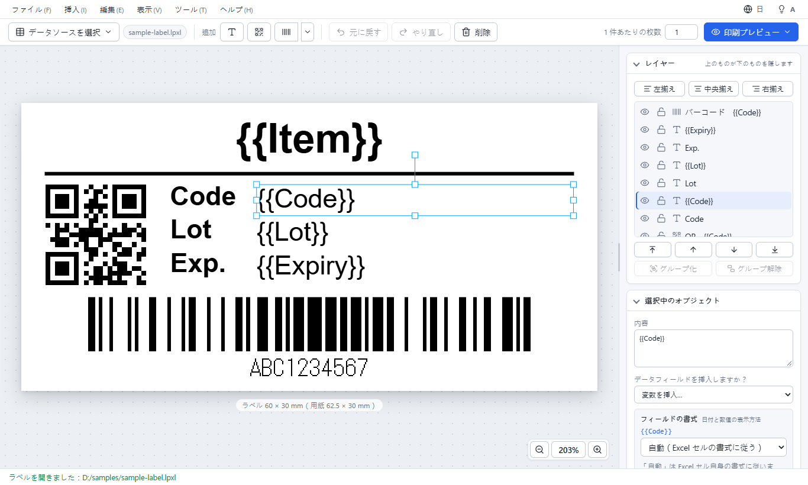
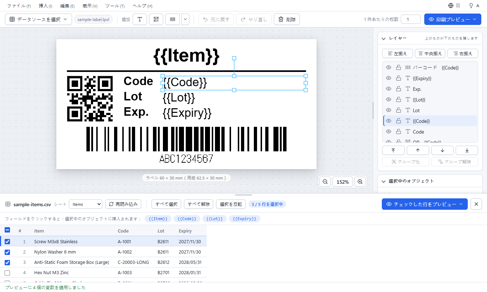
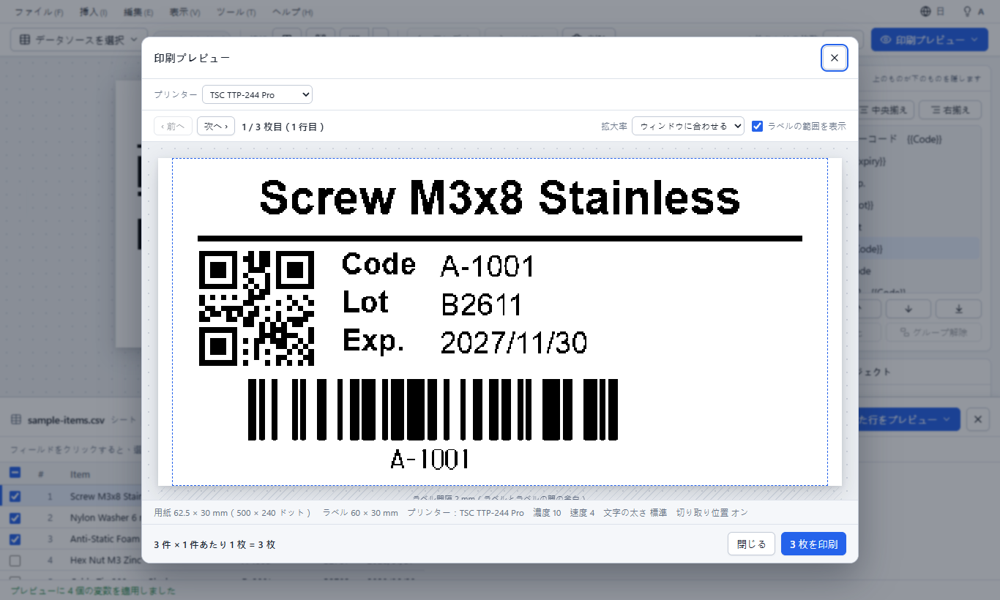
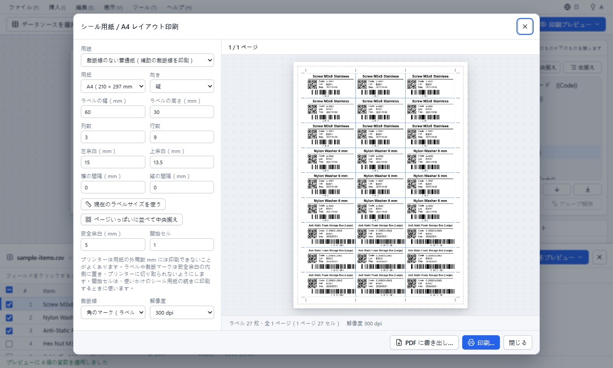
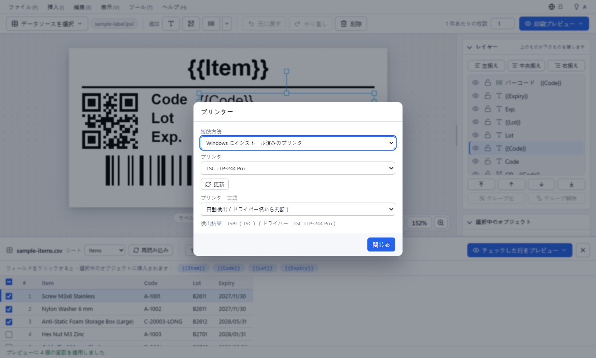

# Label Printer

[English](README.md) · [繁體中文](README.zh-TW.md) · [简体中文](README.zh-CN.md) · [Español](README.es.md) · [Deutsch](README.de.md) · **日本語** · [한국어](README.ko.md)

<p align="center"></p>

オープンソースで無料、軽量な Windows 用ラベル作成・印刷ソフトです。ラベルをレイアウトしてデータソース（Excel、CSV、SQLite、Access、および ODBC で接続できるデータベース）につなげば、内容がそれぞれ違う何百枚ものラベルを一度に印刷できます。TSPL、ZPL、EPL2、CPCL、DPL、SBPL に対応したラベルプリンター（例：TSC TTP-244 Pro）で使えます（TSPL 以外は実験的機能です）。

**Windows 10／11 · オープンソース（MIT）· 完全無料 · インストーラー約 5 MB**

## Label Printer が選ばれる理由

<table>
<tr>
<td valign="top" width="50%"><b>軽くて、すぐ使える</b><br>インストーラーは約 5 MB。データベースサーバーも、アカウント登録も、インターネット接続も不要で、複雑なデザインソフトを先に覚える必要もありません。</td>
<td valign="top" width="50%"><b>デザイン・データ・印刷がひとつの画面に</b><br>ラベルを作り、Excel やデータベースを選び、印刷する行にチェックを入れて「印刷」を押すだけ。Word と Excel が使える人なら数分で使いこなせます。</td>
</tr>
<tr>
<td valign="top" width="50%"><b>本当に無料で、オープン</b><br>ソースコードは MIT ライセンスで公開しています。広告もライセンスキーも枚数制限もなく、ラベルがどこかにアップロードされることもありません。</td>
<td valign="top" width="50%"><b>よく使われるラベルプリンターに対応</b><br>TSC（TSPL）が主な経路で、ZPL、EPL2、CPCL、DPL、SBPL にも対応しています（TSPL 以外は実験的機能）。一般のプリンターなら A4 シート配置に切り替えられます。</td>
</tr>
</table>

## できること

-  **見たままのラベル作成**：テキスト、QR コード、バーコード、線、四角形、画像。ドラッグ、サイズ変更、整列、グループ化、元に戻すができます。
-  **Excel／CSV からそのまま印刷**：ラベルに `{{Item}}`、`{{Lot}}` … を置くだけ。チェックした行が 1 枚ずつのラベルになります。
-  **印刷前にしっかり確認**：印刷プレビューには、プリンターに実際に送られる白黒の画像が 1 枚ずつ表示されます。
-  **長い文字は自動で縮小**：固定範囲を設定しておくと、品名が長いときにフォントサイズが自動で小さくなります。
-  **印刷結果を微調整**：濃度、速度、切り取り位置に加え、mm 目盛り付きの校正ラベルで位置をミリ単位で補正できます。
-  **7 つの言語**：日本語、English、Español、Deutsch、한국어、简体中文、繁體中文。ライトとダークの外観にも対応しています。

## こんな用途に

- **倉庫・出荷**：シリアル番号、ロット番号、有効期限など、内容の異なるラベルを一括で印刷。
- **設備・資産管理**：1 台ごとにラベルを作り、番号と QR コードを載せれば、スキャンするだけで台帳と照合できます。
- **研究室・生産ライン**：試験管、資材、仕掛品のバーコードラベル。項目は既存の Excel やデータベースからそのまま取り込めます。
- **A4 シールとハガキ・封筒用の短冊**：A4 に複数列・複数行でラベルを並べ、必要なら切り取りの目安線を印刷し、プリンターが印刷できない端も避けられます。

## 画面イメージ

<sub>サムネイルをクリックすると大きな画像が表示されます。</sub>

<table>
<tr>
<td align="center" width="50%"><a href="docs/images/ja/data.png"></a><br><sub>データソース（Excel または CSV）を選び、印刷する行にチェックを入れます。フィールド名をクリックすると、選択中のオブジェクトに挿入されます。</sub></td>
<td align="center" width="50%"><a href="docs/images/ja/preview.png"></a><br><sub>印刷プレビュー：プリンターが実際に印刷する状態を 1 枚ずつ表示します。</sub></td>
</tr>
<tr>
<td align="center" width="50%"><a href="docs/images/ja/sheet.png"></a><br><sub>シール用紙／A4 レイアウト：用紙、列数と行数、余白、裁断線を設定します。右側にページ全体のプレビューが表示されます（赤い点線が安全余白です）。</sub></td>
<td align="center" width="50%"><a href="docs/images/ja/printer.png"></a><br><sub>「プリンター」の設定で、接続方法とプリンター言語を選びます。Windows のプリンターではドライバーから言語を自動検出します。</sub></td>
</tr>
</table>

## ダウンロードとインストール

[Releases ページ](https://github.com/mixneko/Label-Printer/releases/latest) を開き、次のどちらかをダウンロードします。
- **`…_x64-setup.exe`**（おすすめ）：インストーラーです。現在のユーザー用にインストールされ、管理者権限は不要です。`.lpxl` ラベルファイルをダブルクリックするとこのアプリで開き、アプリ内での自動更新にも対応します。
- **`…_x64-portable.exe`**：インストール不要。好きな場所にコピーして実行できます。アプリ内でその場で更新することはできません（代わりにダウンロードページが開きます）。

64 ビット版の Windows 10 または 11 が必要です。WebView2 がまだ入っていない PC では、インストーラーが一緒にインストールします。

>  このプログラムはまだコード署名をしていないため、初回の起動時に Windows の青い「Windows によって PC が保護されました」画面が表示されることがあります。**詳細情報 → 実行** をクリックしてください。

## はじめかた

1. **プリンターを選ぶ。** 初めて起動すると「初回設定」が表示されるので、ラベルを印刷するプリンターを選びます（事務用プリンターにラベルを誤って印刷しないよう、プログラムが勝手に選ぶことはありません）。あとで変えるときは **ツール → プリンター…** を開きます。一般のプリンター（事務用プリンター、PDF）を選ぶと、「印刷プレビュー」が直接 A4／シール用紙レイアウトに切り替わります。
2. **用紙サイズを設定する。** **ツール → 用紙とラベルのサイズ…** を開き、用紙とラベルのサイズ（mm）を入力します。
3. **ラベルをデザインする。** **挿入** メニューまたはツールバーからテキスト、QR コード、バーコードなどを追加し、好きな位置にドラッグします。一覧のデータを使うには、テキストに `{{Item}}`（列名を二重の中かっこで囲む）と入力します。
4. **データソースを選ぶ。** **データソースを選択** をクリックして Excel または CSV ファイルを選びます。1 行目が列名、2 行目以降が 1 件ずつのデータです。
5. **チェック、プレビュー、印刷。** 印刷する行にチェックを入れ、**チェックした行をプレビュー → ラベル印刷のプレビュー** を選んで確認してから、プレビュー画面で印刷を押します。各行の枚数は **1 件あたりの枚数** で設定します。

## 便利なヒント

- **日付や数値は Excel の表示どおり。** セルの書式が `yyyy/mm/dd` ならそのまま印刷されます。別の書式にするには `{{Expiry|yyyy-mm-dd}}` のように書きます。
- **品名が長すぎるとき。** テキストオブジェクトを選び、**固定範囲内に制限する（最大範囲）** をオンにして **フォントサイズを自動で縮小** を選びます。入りきらないときだけ文字が小さくなります。
- **複数のオブジェクトを選ぶ。** Ctrl または Shift を押しながらクリックするか、空白部分をドラッグして囲みます。Ctrl+G でグループ化、Ctrl+Shift+G でグループ解除。
- **整列ガイド。** ドラッグ中にピンク色のガイド線が表示されます。Alt を押しながらなら自由に動かせます。
- **ショートカット。** Ctrl+S 保存 · Ctrl+P 印刷プレビュー · Ctrl+Z 元に戻す · Ctrl+Y やり直し · Ctrl+A すべて選択。
- **外観と言語。** 電球ボタンで自動／ライト／ダークを切り替え、地球ボタンで言語を変更できます。

## 印刷が薄い、またはずれているとき

- **薄いとき：** まず **印刷濃度** を上げ（プレビューは変わりませんが、実際の印刷は濃くなります）、必要に応じて速度を下げます。細い線が弱いときは **文字の太さ** を上げると、プレビューにすぐ反映されます。
- **ずれているとき：** **ツール → 印刷品質と紙送り…** を開き、**校正ラベルを作成** をクリックして 1 枚印刷します。四辺の外枠がすべて写っていることを確認し、mm 目盛り（0 が用紙の端）からずれ量を読み取ります。その値を **位置の左右（mm）** と **位置の上下（mm）** に入力してください。印刷が左に寄りすぎているときは左右にプラスの値を、上に寄りすぎているときは上下にプラスの値を入力します。

## 自動更新

インストール版は、起動時にバックグラウンドで GitHub に一度だけ問い合わせます。読み取るのは公開されているリリース情報だけで、お客様のデータは送信しません。新しいバージョンがあるとウィンドウが表示され、**今すぐ更新** を押すと、アプリ内でダウンロード、署名の検証、インストールを行い、自動的に再起動します。起動時の確認は **ヘルプ → 起動時に更新を確認** でオフにでき、**ヘルプ → 新しいバージョンを確認** でいつでも手動で確認できます。

## サンプルファイル

`samples/` フォルダーには、すぐ試せるサンプルが入っています。`sample-label.lpxl`（QR コード、バーコード、日付付きの 60×30 mm 商品ラベル）と、対応するデータ `sample-items.csv`、`sample-items.xlsx`（列は Item、Code、Lot、Expiry）です。ラベルを開いてから、どちらかのデータファイルを選んでください。`sample-items-big5.csv` は同じ一覧を、台湾版 Excel が CSV 保存で使う Big5 エンコードにしたものです。UTF-8 と Big5 は自動で判別されます。

## Web 版 Excel を直接読み込む

クラウド上の表からそのまま印刷できます。同期を待つ必要も、Microsoft にアプリを登録する必要もありません。

- **「データソースを選択」→「Web 版 Excel…」** を選び、表のアドレスを貼り付けて、表示される画面で一度サインインすると、下のデータ表に表示されます。
- クラウドの内容が変わるとデータ表も自動で更新されます（標準は 30 秒ごと。変更・停止も可能）。プレビューと印刷の前にも取り直し、チェックした行が変更・移動されていれば確認できるように止まります。
- 読み取り専用で、ファイルは変更しません。パスワードをプログラムが扱うことはありません。サインイン状態はこのパソコンに残り、「サインアウト」で消去できます。
- SharePoint 上の表で使用しています（ブラウザーのアドレスバーの URL を貼り付けることをおすすめします）。OneDrive と個人アカウントは実験的機能です。組織でファイルのダウンロードが禁止されている場合は使えません。

## データベースに接続する（SQLite、Access、ODBC）

Excel や CSV のほかに、データベースもデータソースにできます。**「データソースを選択」→「データベースに接続…」** を選ぶか、「データソースを選択」で SQLite／Access ファイル（`.db`、`.sqlite`、`.mdb`、`.accdb`）をそのまま選びます。読み込み後は Excel と同じ使い方で、行にチェックを入れてプレビュー・印刷でき、テーブルはドロップダウンで切り替えられます。

- **SQLite**：ファイルを選ぶだけです。実際の SQLite ファイルでテスト済みです。
- **Access**：PC に「Microsoft Access Driver (*.mdb, *.accdb)」が必要です（Microsoft Office、または無料の Access Database Engine と一緒にインストールされます。このプログラムと同じビット数、つまり 64 ビットが必要です）。実際の Access ファイルではまだ検証していないため、実験的機能としています。
- **SQL Server、MySQL／MariaDB、PostgreSQL**：接続機能を内蔵しているので、**ドライバーのインストールは不要**です。ダイアログでデータベースの種類を選び、サーバー・データベース名・ユーザー情報を入力するだけで接続できます（SQL Server は Windows 認証も可）。接続文字列の知識は不要です。既定で暗号化し、サーバー証明書を検証します。社内ネットワークの自己署名証明書は「接続のセキュリティ」で信頼に切り替えられます。読み取り専用の権限のアカウントをおすすめします。MySQL／MariaDB と PostgreSQL は MariaDB 11.8、PostgreSQL 18 で動作確認済み（暗号化接続を含む）です。SQL Server は実際のサーバーでは未検証のため実験的機能としています。その他のデータベースと Access は引き続き ODBC を使い、事前にドライバーのインストールが必要です（「その他の ODBC」で接続文字列を入力）。
- 常に**読み取り専用**で、データベースは変更されません。接続文字列のパスワードはメモリ上にのみ保持され、保存されません。SELECT クエリを 1 つ指定して、必要な列だけを取り出したり行を絞り込んだりすることもできます。日付と数値の列でも `{{フィールド|yyyy/mm/dd}}` の形式指定が使えます。一度に読み込めるのは最大 100,000 行です。それ以上のデータはクエリで絞り込んでください。

## そのほかのラベルプリンターと A4 シール用紙（実験的機能）

次の 2 つの機能は実装済みで自動テストにも合格していますが、**実際のプリンターではまだ検証されていません**。そのため実験的機能としています。お試しいただいた場合は、結果をお知らせください。

**そのほかのラベルプリンター言語。** 標準の TSPL（TSC）のほか、ZPL II、EPL2、CPCL、DPL（Datamax-O'Neil）、SBPL（SATO）を選べます。Windows のプリンターを選ぶと、ドライバー名から言語を推定します。推定できない場合（プログラムが勝手に推測することはありません）や Raw TCP で直接接続する場合は、「プリンター言語」をご自身で選んでください（初回設定、または **ツール → プリンター…**）。ラベルプリンターではない場合（事務用プリンター、PDF など）は「一般のプリンター」を選ぶか自動判定に任せると、「印刷プレビュー」が直接 A4／シール用紙レイアウトに切り替わります。これらの言語では、既定ではビットマップ画像だけを送信します。バーコードや QR コードのプロパティで「プリンターのネイティブコマンドで印刷」にチェックを入れると、プリンター自身のバーコードコマンドを使います（チェックするとフラスコのアイコン付きで「実験中」と表示されます。印刷結果をお知らせください。EPL2 と SBPL には QR コードのコマンドがないため、QR コードは引き続き画像で印刷されます）。

**シール用紙と A4 レイアウト。** **「印刷プレビュー」→「シール用紙／A4 レイアウトのプレビュー…」** を選ぶと（データ表の「チェックした行をプレビュー」からも可能。一般のプリンターを選んでいるときは「印刷プレビュー」で直接開きます）、A4 や Letter に複数列・複数行でラベルを並べられます。

- 「型抜き済みのシール用紙」は裁断線を印刷しません。「裁断線のない普通紙」では、切り抜きの目安になる角のマークや点線のグリッドを印刷できます（封筒用の細長いラベルなど）。
- **安全余白**（標準 5 mm）：プリンターは用紙の最も外側には印刷できないことがよくあります。この範囲にラベルや裁断マークが入ると、プレビューで赤く表示されます。「ページいっぱいに並べて中央揃え」は自動でこの範囲を避けます。
- **開始セル**を使うと、使いかけのシール用紙の続きに印刷できます。PDF に書き出すか、Windows の印刷画面から直接印刷できます（拡大縮小は「100%／実際のサイズ」、余白は「なし」）。

## よくある質問

**プリンターが一覧に表示されません。**  
先に Windows にプリンターをインストールしてください（設定 → プリンターとスキャナー）。そのあと **ツール → プリンター…** を開き、一覧を更新します。

**別のパソコンだとフォントが違って見えます。**  
ラベルは Windows にインストールされているフォントを使います。別のパソコンにも同じフォントをインストールしてください。

**データはどこかに送信されますか？**  
データが誰かに送られることはありません。ネットワークに接続するのは、更新の確認（新しいバージョンがあるかを GitHub に尋ねるだけ）と、ご自身で「Web 版 Excel」やデータベース接続を使うとき（指定した場所に直接接続し、読み取りのみ）だけです。

**ラベルはどこに保存されますか？**  
ご自身で選んだ場所に、拡張子 `.lpxl` のファイルとして保存されます。

## ライセンス

[MIT ライセンス](LICENSE) で公開しています。使用しているサードパーティ製パッケージのライセンスは、アプリの **ヘルプ → サードパーティのライセンス** で確認できます。 画面のアイコンは [Lucide](https://lucide.dev)（ISC ライセンス）のものです。

<details>
<summary><b>開発者向け</b></summary>

技術構成：Tauri 2（Rust）+ TypeScript + Vite + Konva。ラベルはフロントエンドで描画し、バックエンドが 選択したプリンター言語（TSPL、ZPL、EPL2、CPCL、DPL、SBPL）のコマンドを組み立ててプリンターへ送ります（Windows の印刷スプーラーに RAW で送信、または Raw TCP）。

```powershell
npm install
npm run tauri dev        # 開発モード
npm run dist             # ポータブル exe + NSIS インストーラー
npm run test:ui          # UI テスト（Microsoft Edge が必要）
cargo test --manifest-path src-tauri/Cargo.toml
```

必要なもの：Node.js LTS、Rust（「C++ によるデスクトップ開発」ワークロードを含む MSVC ツールチェーン）、WebView2。

`vX.Y.Z` タグを push すると GitHub Actions がビルドして公開します。ワークフローにはリポジトリのシークレット `TAURI_SIGNING_PRIVATE_KEY`（`tauri signer generate` で作成した更新署名用の秘密鍵。公開鍵は `src-tauri/tauri.conf.json` にあります）が必要です。この鍵を紛失すると、インストール済みのアプリを更新できなくなります。

xlsx／csv サンプルの再生成：`cargo run --manifest-path src-tauri/Cargo.toml --example make_samples`。README のスクリーンショットの再生成：`node scripts/make-readme-shots.mjs`。

</details>
