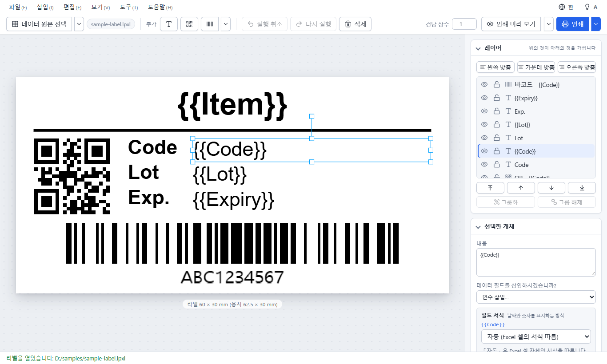
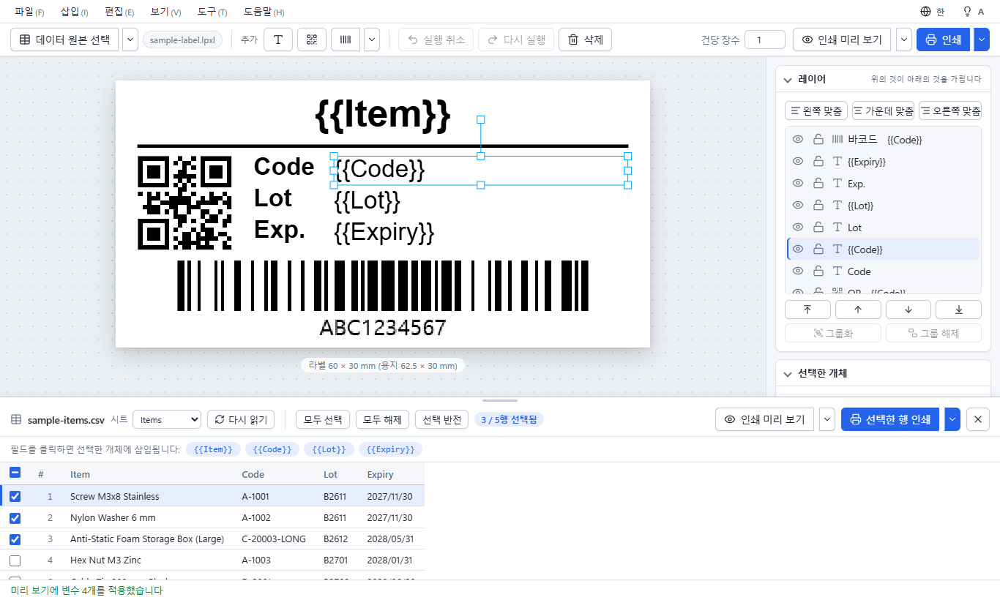
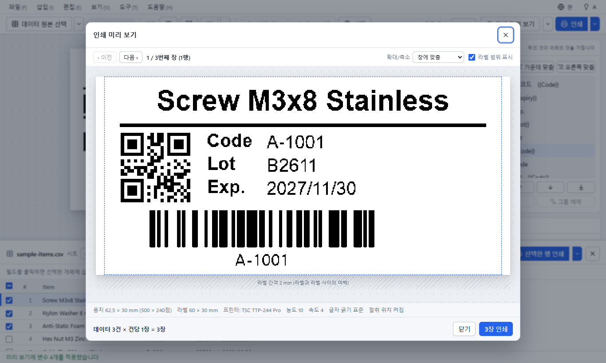
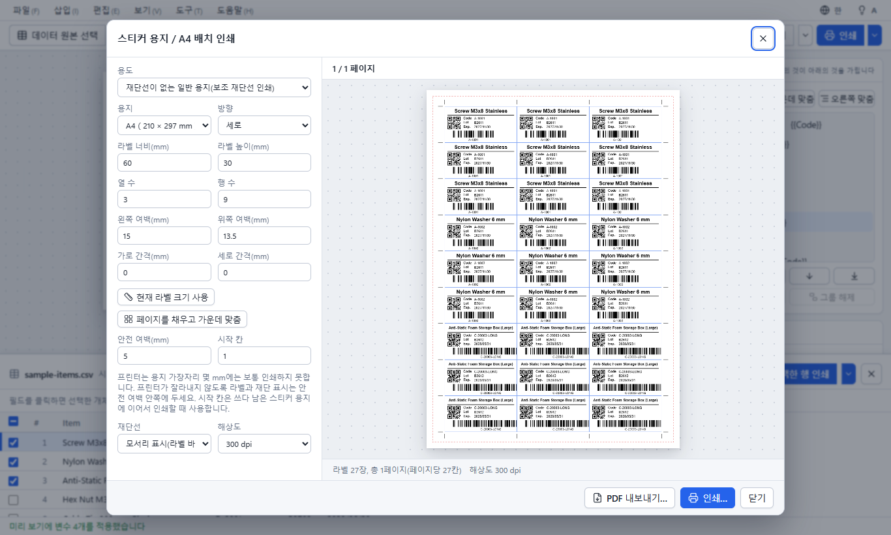
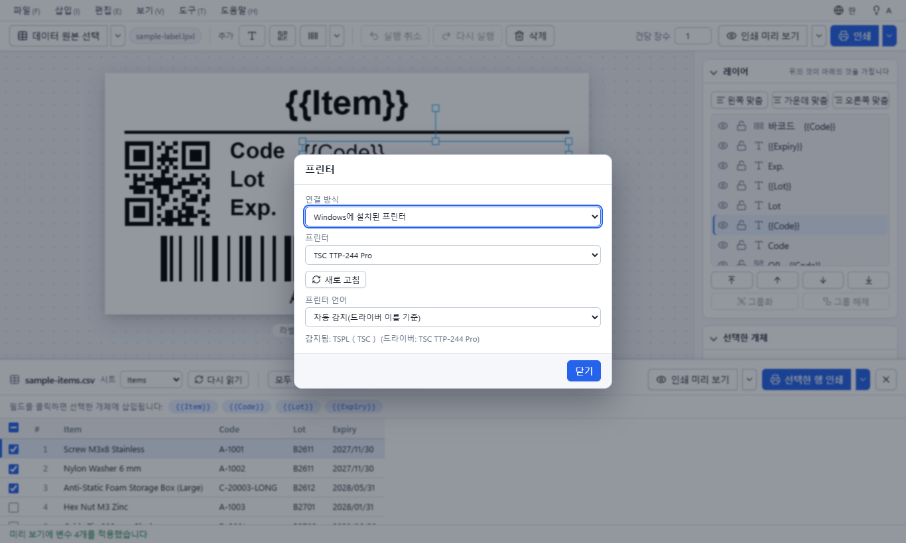

# Label Printer

[繁體中文](README.md) · [English](README.en.md) · [简体中文](README.zh-CN.md) · [Español](README.es.md) · [Deutsch](README.de.md) · [日本語](README.ja.md) · **한국어**

<p align="center"></p>

오픈 소스이며 무료이고 가벼운 Windows용 라벨 디자인·인쇄 프로그램입니다. 라벨을 디자인하고 데이터 원본(Excel, CSV, SQLite, Access 및 ODBC로 연결할 수 있는 데이터베이스)을 연결하면, 내용이 모두 다른 라벨 수백 장을 한 번에 인쇄할 수 있습니다. TSPL, ZPL, EPL2, CPCL, DPL, SBPL을 사용하는 라벨 프린터(예: TSC TTP-244 Pro)에서 사용할 수 있습니다(TSPL 이외는 실험적 기능입니다).

**Windows 10／11 · 오픈 소스(MIT) · 완전 무료 · 설치 파일 약 5 MB**

## Label Printer를 선택하는 이유

<table>
<tr>
<td valign="top" width="50%"><b>가볍고 바로 쓸 수 있습니다</b><br>설치 파일은 약 5 MB입니다. 데이터베이스 서버도, 계정 등록도, 인터넷 연결도 필요 없고, 복잡한 디자인 프로그램을 먼저 배울 필요도 없습니다.</td>
<td valign="top" width="50%"><b>디자인, 데이터, 인쇄를 한 화면에서</b><br>라벨을 만들고, Excel 파일이나 데이터베이스를 고르고, 인쇄할 행을 체크한 다음 인쇄를 누르면 됩니다. Word와 Excel을 쓸 줄 안다면 몇 분이면 익숙해집니다.</td>
</tr>
<tr>
<td valign="top" width="50%"><b>진짜 무료, 진짜 오픈</b><br>소스 코드는 MIT 라이선스로 공개되어 있습니다. 광고도, 라이선스 키도, 매수 제한도 없으며 라벨이 어디에도 업로드되지 않습니다.</td>
<td valign="top" width="50%"><b>흔히 쓰는 라벨 프린터와 호환</b><br>TSC(TSPL)가 주된 경로이며 ZPL, EPL2, CPCL, DPL, SBPL도 지원합니다(TSPL 이외는 실험 기능). 일반 프린터는 A4 스티커 용지 배치로 전환할 수 있습니다.</td>
</tr>
</table>

## 이런 일을 할 수 있습니다

-  **눈으로 보며 라벨 디자인**: 텍스트, QR 코드, 바코드, 선, 사각형, 이미지. 드래그, 크기 조절, 정렬, 그룹화, 실행 취소가 가능합니다.
-  **Excel／CSV로 바로 인쇄**: 라벨에 `{{Item}}`, `{{Lot}}` … 을 넣기만 하면 됩니다. 선택한 행마다 라벨이 한 장씩 인쇄됩니다.
-  **인쇄 전에 미리 확인**: 인쇄 미리 보기에는 프린터로 실제 전송되는 흑백 이미지가 한 장씩 표시됩니다.
-  **긴 글자는 자동으로 축소**: 고정 범위를 지정해 두면 품명이 길 때 글꼴 크기가 자동으로 작아집니다.
-  **인쇄 결과 미세 조정**: 농도, 속도, 절취 위치와 함께 mm 눈금이 있는 보정 라벨로 위치를 밀리미터 단위로 바로잡을 수 있습니다.
-  **7개 언어**: 한국어, English, Español, Deutsch, 日本語, 简体中文, 繁體中文. 밝은 테마와 어두운 테마를 지원합니다.

## 이런 곳에 알맞습니다

- **창고와 출하**: 일련번호, 로트 번호, 유효 기한처럼 내용이 서로 다른 라벨을 한 번에 인쇄합니다.
- **장비와 자산 관리**: 장비마다 번호와 QR 코드가 들어간 라벨을 만들면 스캔 한 번으로 기록을 확인할 수 있습니다.
- **연구실과 생산 라인**: 시험관, 자재, 재공품의 바코드 라벨. 항목은 기존 Excel이나 데이터베이스에서 그대로 가져옵니다.
- **A4 스티커 용지와 봉투 띠지**: A4에 여러 열과 행으로 라벨을 배치하고, 필요하면 절단 보조선을 인쇄하며, 프린터가 인쇄하지 못하는 가장자리를 피합니다.

## 화면 미리 보기

<sub>축소판을 클릭하면 큰 이미지로 볼 수 있습니다.</sub>

<table>
<tr>
<td align="center" width="50%"><a href="docs/images/ko/data.png"></a><br><sub>데이터 원본(Excel 또는 CSV)을 선택하고 인쇄할 행을 선택합니다. 필드 이름을 클릭하면 선택한 개체에 삽입됩니다.</sub></td>
<td align="center" width="50%"><a href="docs/images/ko/preview.png"></a><br><sub>인쇄 미리 보기: 프린터가 실제로 인쇄할 모습을 한 장씩 보여 줍니다.</sub></td>
</tr>
<tr>
<td align="center" width="50%"><a href="docs/images/ko/sheet.png"></a><br><sub>스티커 용지／A4 배치: 용지, 열·행 수, 여백, 재단선을 설정합니다. 오른쪽에 페이지 전체 미리 보기가 표시됩니다(빨간 점선이 안전 여백입니다).</sub></td>
<td align="center" width="50%"><a href="docs/images/ko/printer.png"></a><br><sub>'프린터' 설정에서 연결 방식과 프린터 언어를 선택합니다. Windows 프린터는 드라이버로 언어를 자동 감지합니다.</sub></td>
</tr>
</table>

## 다운로드 및 설치

[Releases 페이지](https://github.com/mixneko/Label-Printer/releases/latest)를 열고 다음 중 하나를 다운로드합니다.
- **`…_x64-setup.exe`**(권장): 설치 프로그램입니다. 현재 사용자 계정에 설치되며 관리자 권한이 필요 없습니다. `.lpxl` 라벨 파일을 더블 클릭하면 이 앱으로 열리고, 앱 안에서 자동으로 업데이트할 수 있습니다.
- **`…_x64-portable.exe`**: 설치 없이 원하는 위치에 복사해 바로 실행합니다. 앱 안에서 제자리 업데이트는 할 수 없으며, 대신 다운로드 페이지가 열립니다.

64비트 Windows 10 또는 11이 필요합니다. PC에 WebView2가 아직 없으면 설치 프로그램이 함께 설치합니다.

>  이 프로그램은 아직 코드 서명이 되어 있지 않아서, 처음 실행할 때 Windows에 파란색 'Windows에서 PC를 보호했습니다' 화면이 나타날 수 있습니다. **추가 정보 → 실행**을 클릭하세요.

## 빠른 시작

1. **프린터 선택.** 처음 시작하면 '처음 설정' 창이 나타나 라벨을 인쇄할 프린터를 고르게 됩니다(라벨이 사무용 프린터로 잘못 나가지 않도록 프로그램이 대신 고르지 않습니다). 나중에 바꾸려면 **도구 → 프린터…**를 엽니다. 일반 프린터(사무용 프린터, PDF)를 고르면 '인쇄'와 '인쇄 미리 보기'가 바로 A4／스티커 용지 배치로 전환됩니다.
2. **용지 크기 설정.** **도구 → 용지 및 라벨 크기…**를 열어 용지와 라벨의 크기(mm)를 입력합니다.
3. **라벨 디자인.** **삽입** 메뉴나 도구 모음에서 텍스트, QR 코드, 바코드 등을 추가하고 원하는 위치로 드래그합니다. 목록의 데이터를 사용하려면 텍스트에 `{{Item}}`(열 이름을 이중 중괄호로 감싼 형태)를 입력합니다.
4. **데이터 원본 선택.** **데이터 원본 선택**를 클릭해 Excel 또는 CSV 파일을 선택합니다. 첫 번째 행은 열 이름이고, 그다음 행마다 데이터 한 건입니다.
5. **선택, 미리 보기, 인쇄.** 필요한 행을 선택하고 **인쇄 미리 보기**로 확인한 뒤 **인쇄**를 클릭합니다. 각 행을 몇 장 인쇄할지는 **건당 장수**에서 설정합니다.

## 유용한 팁

- **날짜와 숫자는 Excel에서 보이는 그대로입니다.** 셀 서식이 `yyyy/mm/dd`이면 그대로 인쇄됩니다. 다른 형식을 쓰려면 `{{Expiry|yyyy-mm-dd}}`처럼 씁니다.
- **품명이 너무 길 때.** 텍스트 개체를 선택하고 **고정 범위로 제한 (최대 범위)**를 켠 다음 **글꼴 크기 자동 축소**를 선택합니다. 들어가지 않을 때만 글자가 작아집니다.
- **여러 개체 선택.** Ctrl 또는 Shift를 누른 채 클릭하거나, 빈 곳에서 드래그해 범위를 지정합니다. Ctrl+G로 그룹화, Ctrl+Shift+G로 그룹 해제.
- **정렬 안내선.** 드래그하는 동안 분홍색 안내선이 나타납니다. Alt를 누르면 자유롭게 이동할 수 있습니다.
- **단축키.** Ctrl+S 저장 · Ctrl+P 인쇄 미리 보기 · Ctrl+Z 실행 취소 · Ctrl+Y 다시 실행 · Ctrl+A 모두 선택.
- **테마와 언어.** 전구 버튼으로 자동／밝게／어둡게를 전환하고, 지구본 버튼으로 언어를 바꿉니다.

## 인쇄가 흐리거나 위치가 어긋날 때

- **너무 흐릴 때:** 먼저 **인쇄 농도**를 높이고(미리 보기는 그대로지만 실제 인쇄는 더 진해집니다) 필요하면 속도를 낮춥니다. 가는 선이 약하면 **글자 굵기**를 높이세요. 미리 보기에 바로 반영됩니다.
- **위치가 어긋날 때:** **도구 → 인쇄 품질 및 용지 이송…**를 열어 **보정 라벨 만들기**를 클릭하고 한 장 인쇄합니다. 사방의 테두리가 모두 나왔는지 확인하고, mm 눈금(0이 용지 가장자리)에서 어긋난 정도를 읽습니다. 그 값을 **좌우 위치 (mm)**와 **상하 위치 (mm)**에 입력하세요. 인쇄가 너무 왼쪽이면 좌우에 양수 값을, 너무 위쪽이면 상하에 양수 값을 입력합니다.

## 자동 업데이트

설치 버전은 시작할 때 백그라운드에서 GitHub에 한 번 문의합니다. 공개된 릴리스 정보만 읽으며 사용자의 데이터는 전송하지 않습니다. 새 버전이 있으면 창이 나타나고, **지금 업데이트**를 누르면 앱 안에서 다운로드하고 서명을 확인한 뒤 설치하고 자동으로 다시 시작합니다. 시작 시 확인은 **도움말 → 시작할 때 업데이트 확인**에서 끌 수 있고, **도움말 → 새 버전 확인**로 언제든 직접 확인할 수 있습니다.

## 샘플 파일

`samples/` 폴더에 바로 써 볼 수 있는 예제가 들어 있습니다. `sample-label.lpxl`(QR 코드, 바코드, 날짜가 있는 60×30 mm 상품 라벨)과 짝이 되는 데이터 `sample-items.csv`, `sample-items.xlsx`(열: Item, Code, Lot, Expiry)입니다. 라벨을 먼저 열고 데이터 파일 중 하나를 선택하세요. `sample-items-big5.csv`는 같은 목록을 대만판 Excel이 CSV로 저장할 때 쓰는 Big5 인코딩으로 만든 것이며, 프로그램이 UTF-8과 Big5를 자동으로 판별합니다.

## 데이터베이스에 연결하기(SQLite, Access, ODBC)

Excel과 CSV 외에 데이터베이스도 데이터 원본으로 쓸 수 있습니다. **'데이터 원본 선택' 오른쪽의 ▾ → '데이터베이스에 연결…'** 을 선택하거나, '데이터 원본 선택'에서 SQLite／Access 파일(`.db`, `.sqlite`, `.mdb`, `.accdb`)을 바로 고르세요. 불러온 뒤에는 Excel과 똑같이 행을 선택하고 미리 보기·인쇄할 수 있으며, 테이블은 드롭다운 목록에서 전환합니다.

- **SQLite**: 파일만 고르면 됩니다. 실제 SQLite 파일로 테스트했습니다.
- **Access**: PC에 'Microsoft Access Driver (*.mdb, *.accdb)'가 필요합니다(Microsoft Office 또는 무료 Access Database Engine과 함께 설치되며, 이 프로그램과 같은 비트 수인 64비트여야 합니다). 실제 Access 파일로는 아직 검증하지 않아 실험적 기능으로 표시했습니다.
- **SQL Server, MySQL／MariaDB, PostgreSQL**: 연결 기능이 내장되어 있어 **드라이버를 설치할 필요가 없습니다**. 대화 상자에서 데이터베이스 종류를 고르고 서버, 데이터베이스 이름, 계정과 암호를 입력하면 연결됩니다(SQL Server는 Windows 인증도 가능). 연결 문자열은 몰라도 됩니다. 기본으로 암호화하고 서버 인증서를 검증하며, 내부 네트워크의 자체 서명 인증서는 '연결 보안'에서 신뢰로 바꿀 수 있습니다. 읽기 전용 권한의 계정을 권장합니다. MySQL／MariaDB와 PostgreSQL은 MariaDB 11.8, PostgreSQL 18로 테스트했으며(암호화 연결 포함), SQL Server는 실제 서버로 아직 검증하지 않아 실험 기능으로 표시했습니다. 그 밖의 데이터베이스와 Access는 계속 ODBC를 쓰며 드라이버를 먼저 설치해야 합니다('기타 ODBC'에서 연결 문자열 입력).
- 항상 **읽기 전용**이며 데이터베이스는 변경되지 않습니다. 연결 문자열의 암호는 메모리에만 보관되고 저장되지 않습니다. SELECT 쿼리 하나를 추가해 필요한 열만 가져오거나 행을 걸러낼 수도 있습니다. 날짜와 숫자 열도 `{{필드|yyyy/mm/dd}}` 형식을 쓸 수 있습니다. 한 번에 최대 100,000행까지 읽으며, 더 큰 데이터는 쿼리로 범위를 좁히세요.

## 그 밖의 라벨 프린터와 A4 스티커 용지(실험적 기능)

아래 두 기능은 구현이 끝났고 자동 테스트도 통과했지만 **실제 프린터에서는 아직 검증되지 않았습니다**. 그래서 실험적 기능으로 표시했습니다. 사용해 보셨다면 결과를 알려 주세요.

**그 밖의 라벨 프린터 언어.** 기본 TSPL(TSC) 외에 ZPL II, EPL2, CPCL, DPL(Datamax-O'Neil), SBPL(SATO)을 선택할 수 있습니다. Windows 프린터를 선택하면 드라이버 이름으로 언어를 추정합니다. 추정하지 못하거나(프로그램이 대신 짐작하지 않습니다) Raw TCP로 직접 연결할 때는 '프린터 언어'를 직접 선택하세요(처음 설정 또는 **도구 → 프린터…**). 라벨 프린터가 아니라면(사무용 프린터, PDF 등) '일반 프린터'를 고르거나 자동 감지에 맡기세요. 이후 '인쇄'와 '인쇄 미리 보기'가 바로 A4／스티커 용지 배치로 전환됩니다. 이 언어들은 기본적으로 비트맵 이미지만 전송합니다. 바코드나 QR 코드의 속성에서 '프린터 기본 명령으로 인쇄'를 선택하면 프린터 자체의 바코드 명령을 사용합니다(선택하면 플라스크 아이콘과 함께 '실험 중'이 표시되며, 인쇄 결과를 알려 주세요. EPL2와 SBPL에는 QR 코드 명령이 없어 QR 코드는 계속 이미지로 인쇄됩니다).

**스티커 용지와 A4 배치.** **'인쇄' 오른쪽의 ▾ → '스티커 용지／A4 배치 인쇄…'**(또는 '인쇄 미리 보기' 오른쪽의 ▾에서도 열 수 있으며, 일반 프린터를 선택한 경우에는 '인쇄'나 '인쇄 미리 보기'를 누르기만 해도 열립니다)를 선택하면 A4 또는 Letter에 여러 열·행으로 라벨을 배치할 수 있습니다.

- '재단된 스티커 용지'는 재단선을 인쇄하지 않습니다. '재단선이 없는 일반 용지'는 자르기 편하도록 모서리 표시나 점선 격자를 인쇄할 수 있습니다(예: 봉투용 띠 라벨).
- **안전 여백**(기본 5 mm): 프린터는 용지 가장 바깥쪽에는 인쇄하지 못하는 경우가 많습니다. 이 범위 안에 라벨이나 재단 표시가 들어가면 미리 보기에서 빨갛게 표시됩니다. '페이지를 채우고 가운데 맞춤'은 이 범위를 자동으로 피합니다.
- **시작 칸**을 쓰면 쓰다 남은 스티커 용지에 이어서 인쇄할 수 있습니다. PDF로 내보내거나 Windows 인쇄 창에서 바로 인쇄할 수 있습니다(배율 '100%／실제 크기', 여백 '없음').

## 자주 묻는 질문

**프린터가 목록에 없습니다.**  
먼저 Windows에 프린터를 설치하세요(설정 → 프린터 및 스캐너). 그런 다음 **도구 → 프린터…**를 열고 목록을 새로 고칩니다.

**다른 컴퓨터에서는 글꼴이 다르게 보입니다.**  
라벨은 Windows에 설치된 글꼴을 사용합니다. 다른 컴퓨터에도 같은 글꼴을 설치하세요.

**제 데이터가 어딘가로 전송되나요?**  
아니요. 프로그램은 오프라인으로 동작합니다. 네트워크에 접속하는 것은 위에서 설명한 업데이트 확인뿐이며, 새 버전이 있는지 GitHub에 묻기만 합니다.

**라벨은 어디에 저장되나요?**  
직접 선택한 위치에 확장자 `.lpxl` 파일로 저장됩니다.

## 라이선스

[MIT 라이선스](LICENSE)로 공개되어 있습니다. 사용한 타사 패키지의 라이선스는 앱의 **도움말 → 타사 라이선스**에서 확인할 수 있습니다. 화면의 아이콘은 [Lucide](https://lucide.dev)(ISC 라이선스)를 사용합니다.

<details>
<summary><b>개발자용</b></summary>

기술 구성: Tauri 2(Rust) + TypeScript + Vite + Konva. 라벨은 프런트엔드에서 렌더링하고, 백엔드가 선택한 프린터 언어(TSPL, ZPL, EPL2, CPCL, DPL, SBPL)의 명령을 만들어 프린터로 보냅니다(Windows 인쇄 스풀러에 RAW로 전송, 또는 Raw TCP).

```powershell
npm install
npm run tauri dev        # 개발 모드
npm run tauri build      # 포터블 exe + NSIS 설치 프로그램
npm run test:ui          # UI 테스트(Microsoft Edge 필요)
cargo test --manifest-path src-tauri/Cargo.toml
```

요구 사항: Node.js LTS, Rust(“C++를 사용한 데스크톱 개발” 워크로드가 포함된 MSVC 툴체인), WebView2.

`vX.Y.Z` 태그를 푸시하면 GitHub Actions가 빌드하고 배포합니다. 워크플로에는 저장소 시크릿 `TAURI_SIGNING_PRIVATE_KEY`(`tauri signer generate`로 만든 업데이트 서명용 개인 키, 공개 키는 `src-tauri/tauri.conf.json`에 있음)가 필요합니다. 이 키를 잃어버리면 이미 설치된 앱을 더 이상 업데이트할 수 없습니다.

xlsx／csv 샘플 다시 만들기: `cargo run --manifest-path src-tauri/Cargo.toml --example make_samples`. README 스크린샷 다시 만들기: `node scripts/make-readme-shots.mjs`.

</details>
