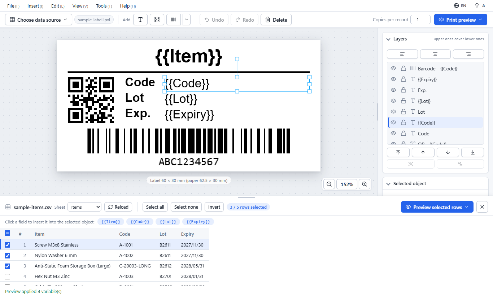
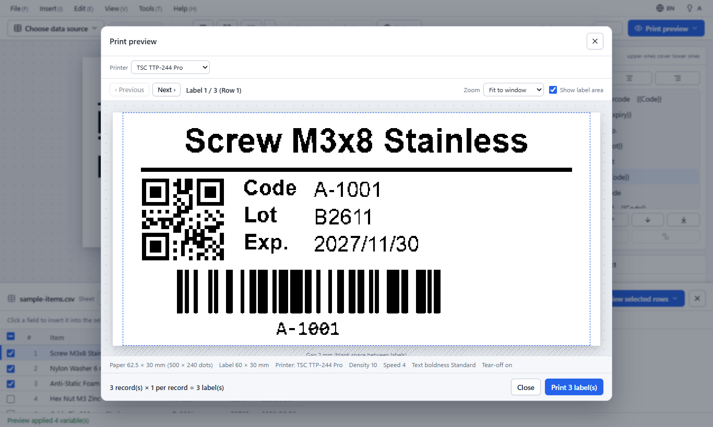
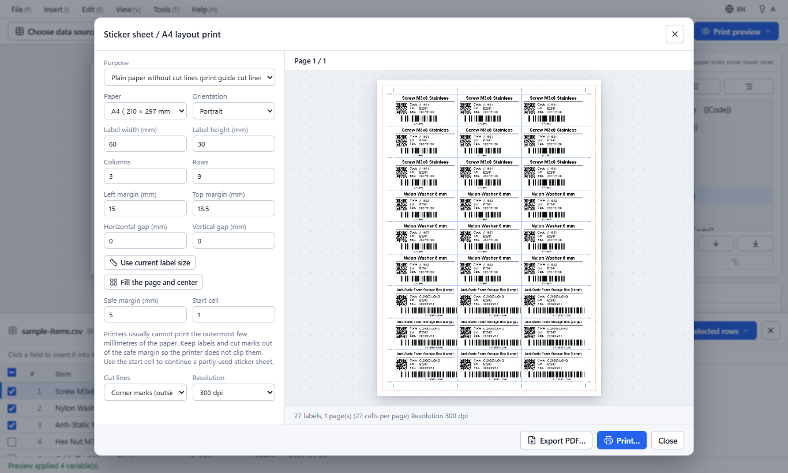
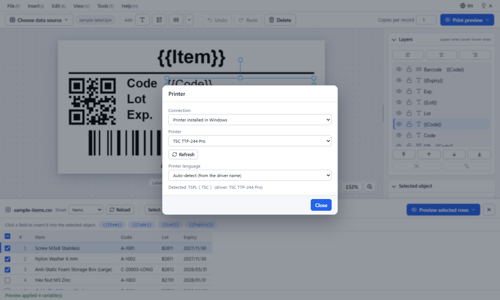

# Label Printer

**English** · [繁體中文](README.zh-TW.md) · [简体中文](README.zh-CN.md) · [Español](README.es.md) · [Deutsch](README.de.md) · [日本語](README.ja.md) · [한국어](README.ko.md)

<p align="center"></p>

Open-source, free, lightweight label design and printing for Windows, and a free alternative to BarTender for thermal label printers. Lay out a label, connect a data source (Excel, CSV, SQLite, Access, or any database reachable through ODBC), and print hundreds of different labels in one go. Works with label printers that use TSPL, ZPL, EPL2, CPCL, DPL or SBPL, such as the TSC TTP-244 Pro (everything except TSPL is experimental).

**Windows 10/11 · Open source (MIT) · Completely free · about 5 MB installer**

## Why Label Printer

<table>
<tr>
<td valign="top" width="50%"><b>Light, and ready to use</b><br>The installer is only about 5 MB. No database server, no account to register, no internet connection needed, and no complicated design suite to learn first.</td>
<td valign="top" width="50%"><b>Design, data and printing in one window</b><br>Lay out a label, pick an Excel file or a database, tick the rows to print and press Print. If you can use Word and Excel, you can be productive in minutes.</td>
</tr>
<tr>
<td valign="top" width="50%"><b>Genuinely free and open</b><br>The source code is published under the MIT license. No ads, no license keys, no limit on the number of labels, and your labels are never uploaded anywhere.</td>
<td valign="top" width="50%"><b>Works with common label printers</b><br>TSC (TSPL) is the main path, with ZPL, EPL2, CPCL, DPL and SBPL also supported (everything except TSPL is experimental); an ordinary printer can switch to A4 sticker-sheet layout.</td>
</tr>
</table>

## What you can do

-  **Design labels visually**: Text, QR codes, barcodes, lines, rectangles and pictures. Drag, resize, align, group and undo.
-  **Print from Excel or CSV**: Put `{{Item}}`, `{{Lot}}` … on the label. Every row you tick becomes one label.
-  **See it before you print**: Print preview shows exactly the black-and-white image that is sent to the printer, label by label.
-  **Long text fits itself**: Set a fixed area and the font size shrinks automatically when a name is too long.
-  **Fine-tune the printout**: Density, speed, tear-off position and a ruler-style calibration label to correct the position to the millimetre.
-  **Seven languages**: English, Español, Deutsch, 日本語, 한국어, 简体中文 and 繁體中文, in light or dark appearance.

## Good for

- **Warehouse and shipping**: Serial numbers, lot numbers and expiry dates: print a whole batch of different labels in one go.
- **Equipment and asset management**: One label per device with its number and a QR code, so a scan takes you straight to the record.
- **Labs and production lines**: Barcode labels for tubes, materials and work in progress, with fields taken straight from your existing Excel file or database.
- **A4 sticker sheets and envelope strips**: Lay labels out in columns and rows on A4, print cut guide lines when needed, and stay clear of the edge the printer cannot reach.

## Screenshots

<sub>Click a thumbnail to see it full size.</sub>

<table>
<tr>
<td align="center" width="50%"><a href="docs/images/en/data.png"></a><br><sub>Choose a data source (Excel or CSV) and tick the rows to print. Click a field name to insert it into the selected object.</sub></td>
<td align="center" width="50%"><a href="docs/images/en/preview.png"></a><br><sub>Print preview shows each label as the printer will print it.</sub></td>
</tr>
<tr>
<td align="center" width="50%"><a href="docs/images/en/sheet.png"></a><br><sub>Sticker sheet / A4 layout: set the paper, columns and rows, margins and cut lines. The page preview is on the right (the red dashed line is the safe margin).</sub></td>
<td align="center" width="50%"><a href="docs/images/en/printer.png"></a><br><sub>Choose the connection and the printer language in the Printer settings. For a Windows printer the language is detected from the driver.</sub></td>
</tr>
</table>

## Download and install

Open the [Releases page](https://github.com/mixneko/Label-Printer/releases/latest) and download one of these:
- **`…_x64-setup.exe`** (recommended): installer. It installs for the current user and needs no administrator rights. Double-clicking a `.lpxl` label file opens it in the app, and the app can update itself.
- **`…_x64-portable.exe`**: no installation; copy it anywhere and run it. It cannot update itself in place (it opens the download page instead).

Requires 64-bit Windows 10 or 11. The installer adds the WebView2 component if your PC does not have it yet.

>  The program is not code-signed yet, so Windows may show a blue “Windows protected your PC” notice the first time. Click **More info → Run anyway**.

## Quick start

1. **Choose your printer.** The first time you start the program, a “First-time setup” window asks which printer to print labels on (the program does not choose for you, so labels are not sent to an office printer by mistake). To change it later, open **Tools → Printer…**. If you pick an ordinary printer (an office printer, PDF), **Print preview** switches straight to the A4 / sticker sheet layout.
2. **Set the paper size.** Open **Tools → Paper and label size…** and enter your paper and label size in millimetres.
3. **Design the label.** Use the **Insert** menu or the toolbar to add text, QR codes, barcodes and so on, and drag them into place. To use data from a list, type `{{Item}}` (a column name between double braces) in the text.
4. **Choose the data source.** Click **Choose data source** and pick an Excel or CSV file. The first row holds the column names; every following row is one record.
5. **Tick, preview, print.** Tick the rows you need, click **Preview selected rows → Preview label printing**, check the result, then press Print in the preview window. **Copies per record** sets how many copies of each row are printed.

## Helpful tips

- **Dates and numbers look the same as in Excel.** A cell formatted `yyyy/mm/dd` prints that way. To choose another format, write `{{Expiry|yyyy-mm-dd}}`.
- **Names that are too long.** Select the text object, turn on **Limit to a fixed area (maximum area)**, then choose **Shrink the font size automatically**. The text gets smaller only when it needs to.
- **Select several objects.** Hold Ctrl or Shift and click, or drag a box around them. Ctrl+G groups them, Ctrl+Shift+G ungroups.
- **Alignment guides.** Pink guide lines appear while you drag; hold Alt to move freely.
- **Shortcuts.** Ctrl+S save · Ctrl+P print preview · Ctrl+Z undo · Ctrl+Y redo · Ctrl+A select all.
- **Appearance and language.** The light-bulb button switches between automatic, light and dark; the globe button changes the language.

## Printout too light, or shifted?

- **Too light:** raise **Print density** first (the preview does not change, but the printout gets darker), then lower the speed. If thin strokes look weak, raise **Text boldness**; the preview shows the effect immediately.
- **Shifted:** open **Tools → Print quality and feeding…**, click **Create calibration label** and print one. Check that all four border edges are complete, and read the offset from the millimetre ticks (0 is the paper edge). Then enter the correction in **Horizontal shift (mm)** and **Vertical shift (mm)**. If the printout is too far left, enter a positive horizontal value; if it is too high, enter a positive vertical value.

## Automatic updates

The installed version checks GitHub once in the background when it starts. It only reads the public release information and sends none of your data. When a new version exists, a window offers **Update now**: the update is downloaded inside the app, its signature is verified, it is installed, and the app restarts. You can turn the startup check off under **Help → Check for updates at startup**, or check manually with **Help → Check for updates**.

## Sample files

The `samples/` folder contains a ready-to-use example: `sample-label.lpxl` (a 60×30 mm product label with QR code, barcode and date) with matching data in `sample-items.csv` and `sample-items.xlsx` (columns Item, Code, Lot, Expiry). Open the label, then choose one of the data files. `sample-items-big5.csv` is the same list in the Big5 encoding that Taiwanese Excel uses when saving CSV; the program detects UTF-8 and Big5 automatically.

## Reading Excel for the web

Print straight from a spreadsheet in the cloud: no waiting for it to sync, and no app registration with Microsoft.

- Click **Choose data source → Excel for the web…**, paste the spreadsheet address and sign in once in the window that appears. The data shows up in the table below.
- When the cloud file changes, the table updates itself (every 30 seconds by default; adjustable or off). The latest data is fetched again before preview and print; if ticked rows changed or moved, it stops so you can check.
- Read-only; your file is never modified. The program never handles your password. The sign-in stays on this computer and “Sign out” clears it.
- Used with spreadsheets on SharePoint (pasting the address from the browser's address bar is recommended); OneDrive and personal accounts are experimental. It cannot work if your organisation blocks downloading files.

## Connecting to a database (SQLite, Access, ODBC)

Besides Excel and CSV, a database can be your data source: click **Choose data source → Connect to database…**, or simply pick a SQLite or Access file (`.db`, `.sqlite`, `.mdb`, `.accdb`) in “Choose data source”. After loading, it works like Excel: tick rows, preview, print, and switch tables from the drop-down list.

- **SQLite**: just choose the file. Tested with real SQLite files.
- **Access**: needs the “Microsoft Access Driver (*.mdb, *.accdb)” on your PC (installed with Microsoft Office or the free Access Database Engine; it must have the same bitness as this program, that is 64-bit). Not yet verified with a real Access file, so it is marked experimental.
- **SQL Server, MySQL/MariaDB, PostgreSQL**: the connection is built in, so **no driver needs to be installed**. Pick the database type in the dialog and fill in the server, database name and credentials (SQL Server can also use Windows authentication); no connection string needed. Connections are encrypted and the server certificate is verified by default; for a self-signed certificate on an internal network, change “Connection security” to trust it. An account with read-only permission is recommended. MySQL/MariaDB and PostgreSQL have been tested against MariaDB 11.8 and PostgreSQL 18 (including encrypted connections); SQL Server has not yet been verified against a real server, so it is marked experimental. Other databases and Access still use ODBC and need their driver installed first (choose “Other ODBC” and enter a connection string).
- Always **read-only**; the database is never modified, and a password in the connection string is kept in memory only and never saved. You can add a SELECT query to take only the columns you need or to filter rows. Date and number columns also work with `{{Field|yyyy/mm/dd}}` formats. At most 100,000 rows are read at once; for larger data, narrow it down with a query.

## Other label printers and A4 sticker sheets (experimental)

The two features below are written and pass the automated tests, but they have **not been verified on real printers yet**, so they are marked experimental. If you try them, please report how it went.

**Other label printer languages.** Besides the default TSPL (TSC), you can choose ZPL II, EPL2, CPCL, DPL (Datamax-O'Neil) and SBPL (SATO). When you pick a Windows printer, the program guesses the language from the driver name; if it cannot (it never guesses for you), or if you connect with Raw TCP, choose the **Printer language** yourself (in the first-time setup, or under **Tools → Printer…**). If the printer is not a label printer (an office printer, PDF and so on), choose “Ordinary printer” or let the program detect it; **Print preview** then switches straight to the A4 / sticker sheet layout. By default these languages only send a bitmap. Tick “Print with the printer's native commands” in a barcode's or QR code's properties to use the printer's own barcode commands instead (an “Experimental” notice with a flask icon appears when you do; please report how the printout turns out; EPL2 and SBPL have no QR code command, so QR codes are still printed as images).

**Sticker sheets and A4 layout.** Click **Print preview → Sticker sheet / A4 layout preview…** (also under “Preview selected rows” above the data table; with an ordinary printer selected, Print preview opens it directly) to place labels in several columns and rows on A4 or Letter:

- “Die-cut sticker sheet” prints no cut lines; “Plain paper without cut lines” can print corner marks or dashed grid lines to help you cut (for example envelope strips).
- **Safe margin** (5 mm by default): printers usually cannot print the outermost edge of the paper. Labels or cut marks placed inside that band are shown in red in the preview. “Fill the page and center” keeps clear of it automatically.
- **Start cell** lets you continue a partly used sticker sheet. You can export a PDF or print directly through the Windows print window (choose scale “100% / actual size” and margins “None”).

## FAQ

**My printer is not in the list.**  
Install the printer in Windows first (Settings → Printers & scanners). Then open **Tools → Printer…** and refresh the list.

**The fonts look different on another computer.**  
Labels use the fonts installed in Windows. Install the same fonts on the other computer.

**Is my data sent anywhere?**  
Your data is not sent to anyone. The program goes online only to check for updates (it just asks GitHub whether a newer version exists) and when you yourself use Excel for the web or connect to a database (it connects straight to the place you specify, read-only).

**Where are my labels saved?**  
Wherever you choose, as files with the extension `.lpxl`.

## License

Released under the [MIT License](LICENSE). The licenses of the third-party packages used are listed in the app under **Help → Third-party licenses**. The interface icons come from [Lucide](https://lucide.dev) (ISC license).

<details>
<summary><b>For developers</b></summary>

Tech stack: Tauri 2 (Rust) + TypeScript + Vite + Konva. The label is rendered in the front end; the back end builds the commands for the selected printer language (TSPL, ZPL, EPL2, CPCL, DPL or SBPL) and sends them to the printer (Windows spooler RAW, or Raw TCP).

```powershell
npm install
npm run tauri dev        # development mode
npm run dist             # portable exe + NSIS installer
npm run test:ui          # UI tests (needs Microsoft Edge)
cargo test --manifest-path src-tauri/Cargo.toml
```

Requirements: Node.js LTS, Rust (MSVC toolchain with the “Desktop development with C++” workload) and WebView2.

Releases are built by GitHub Actions when a `vX.Y.Z` tag is pushed. The workflow needs the repository secret `TAURI_SIGNING_PRIVATE_KEY` (the update-signing private key made with `tauri signer generate`; the public key is in `src-tauri/tauri.conf.json`). If that key is lost, installed copies can no longer be updated.

Regenerate the xlsx/csv samples: `cargo run --manifest-path src-tauri/Cargo.toml --example make_samples`. Regenerate the README screenshots: `node scripts/make-readme-shots.mjs`.

</details>
