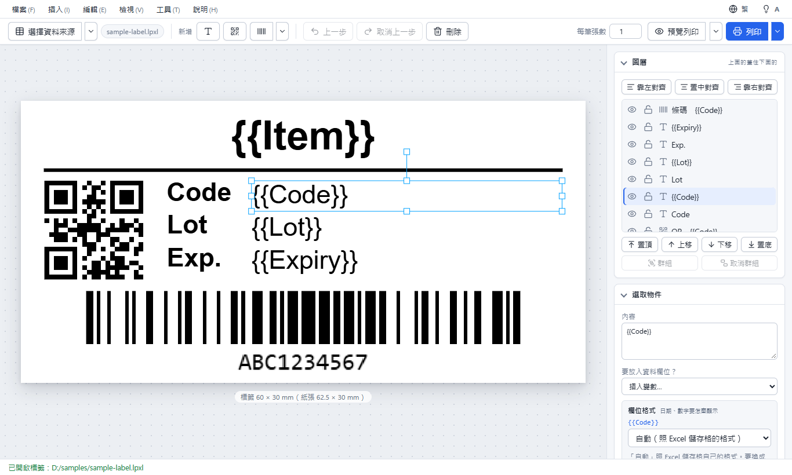
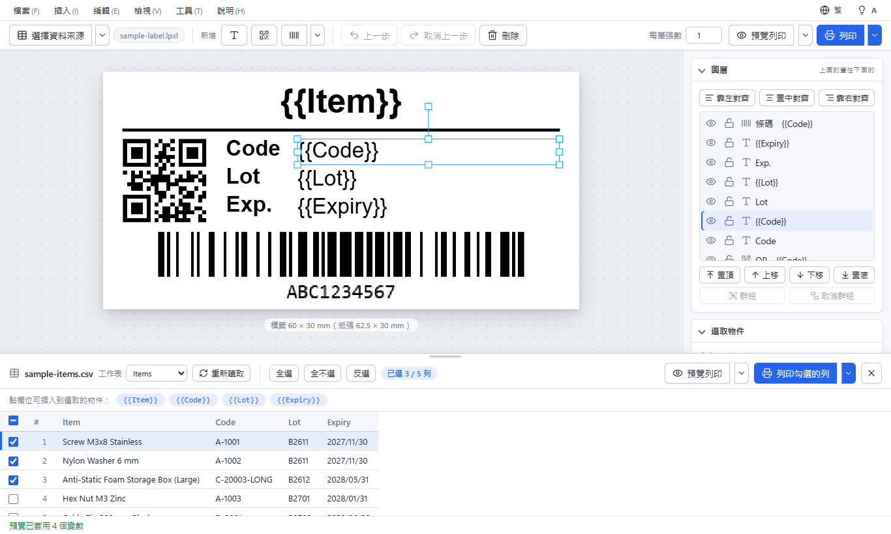
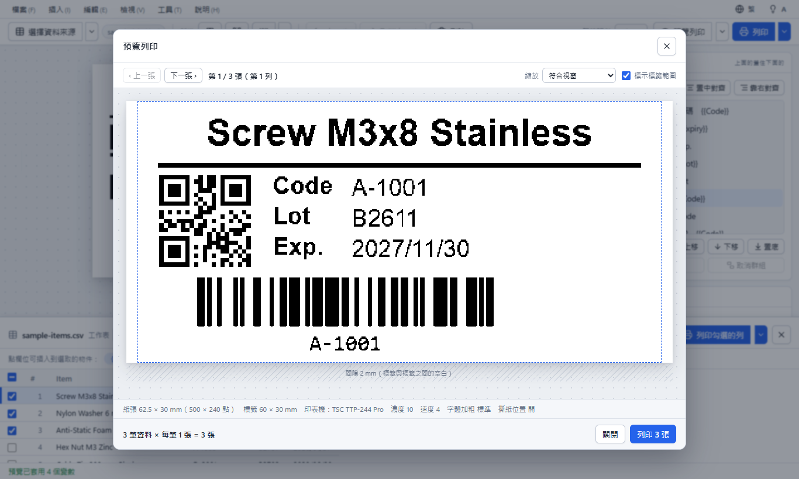
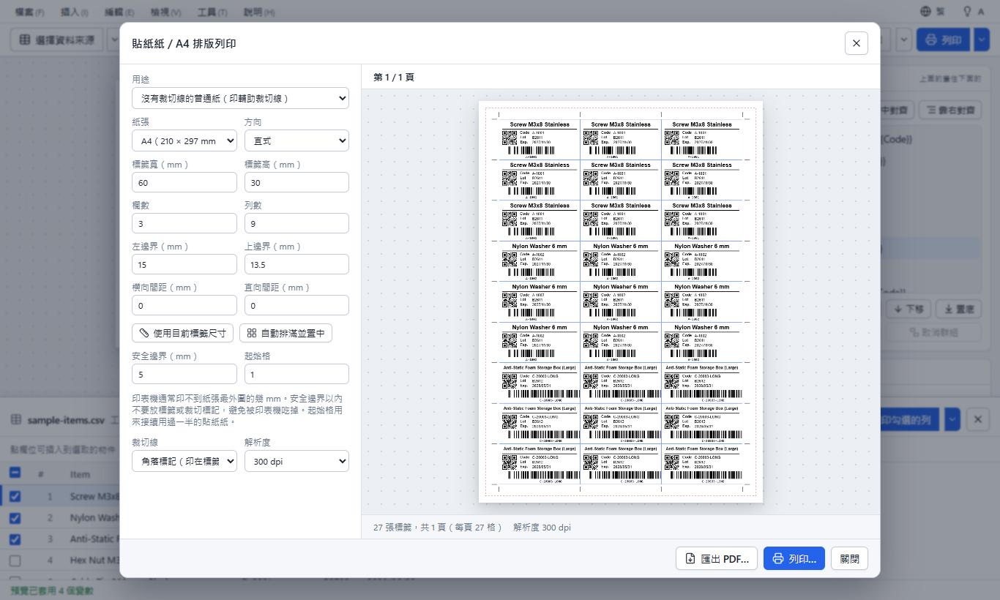
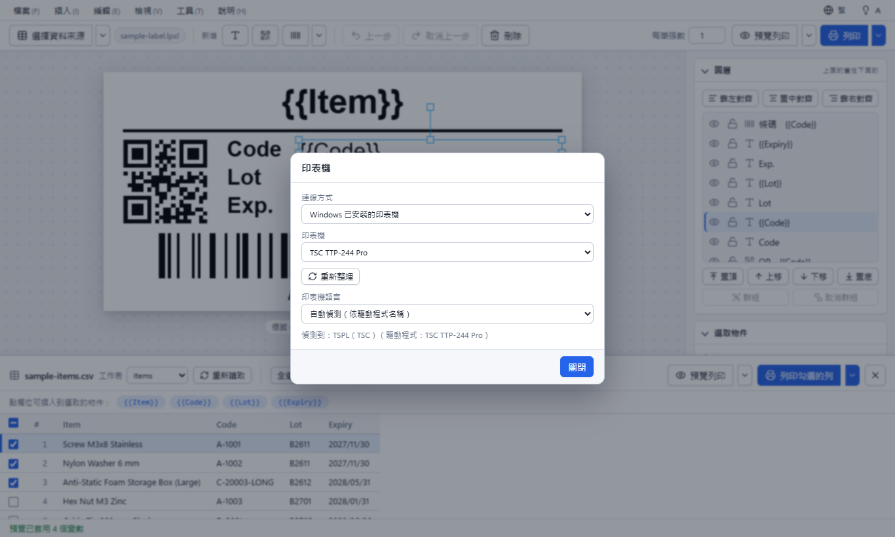

# Label Printer

**繁體中文** · [English](README.en.md) · [简体中文](README.zh-CN.md) · [Español](README.es.md) · [Deutsch](README.de.md) · [日本語](README.ja.md) · [한국어](README.ko.md)

<p align="center"></p>

開源、免費、輕量的 Windows 標籤設計與列印軟體。排好一張標籤、連接資料來源（Excel、CSV、SQLite、Access，以及能用 ODBC 連線的資料庫），就能一次印出幾百張內容各不相同的標籤。支援 TSPL、ZPL、EPL2、CPCL、DPL、SBPL 等指令語言的標籤機（例如 TSC TTP-244 Pro；TSPL 以外為實驗性質）。

**Windows 10／11 · 開源（MIT）· 完全免費 · 安裝檔約 5 MB**

## 為什麼選 Label Printer

<table>
<tr>
<td valign="top" width="50%"><b>輕巧，打開就能用</b><br>安裝檔只有約 5 MB，不需要資料庫伺服器、不需要註冊帳號、不需要連網，也不必先學會一套複雜的設計軟體。</td>
<td valign="top" width="50%"><b>設計、資料、列印在同一個畫面</b><br>排好一張標籤，選一份 Excel 或資料庫，勾選要印的列，按下列印。會用 Word 與 Excel 的人，幾分鐘就能上手。</td>
</tr>
<tr>
<td valign="top" width="50%"><b>真正的免費與開放</b><br>原始碼以 MIT 授權公開；沒有廣告、沒有授權碼、沒有張數限制，也不會把你的標籤上傳到任何地方。</td>
<td valign="top" width="50%"><b>接得上常見的標籤機</b><br>TSC（TSPL）已是主要使用的路徑，也支援 ZPL、EPL2、CPCL、DPL、SBPL（TSPL 以外為實驗性質）；一般印表機還能改用 A4 貼紙紙排版。</td>
</tr>
</table>

## 可以做什麼

-  **所見即所得的標籤設計**：文字、QR Code、條碼、線條、矩形與圖片，可拖曳、縮放、對齊、群組，也能復原。
-  **直接用 Excel／CSV 列印**：在標籤上放 `{{Item}}`、`{{Lot}}`……勾選的每一列資料就印成一張標籤。
-  **印之前先看清楚**：預覽列印顯示實際送給印表機的黑白影像，可逐張翻看。
-  **太長的字自己縮小**：設定固定範圍後，品名太長時字級會自動縮小，不會被切掉。
-  **印出來可以微調**：濃度、速度、撕紙位置，還有附 mm 刻度的校正標籤，可把位置修正到毫米。
-  **七種語言**：繁體中文、简体中文、English、Español、Deutsch、日本語、한국어，並有亮色與暗色外觀。

## 適合用在

- **倉儲與出貨**：序號、批號、有效日期，一次印出整批內容各不相同的標籤。
- **設備與資產管理**：每台設備一張標籤，帶上編號與 QR Code，掃一下就能對照資料。
- **實驗室與生產線**：試管、物料與半成品的條碼標示，欄位直接來自現有的 Excel 或資料庫。
- **A4 貼紙紙與信封條**：在 A4 上排出多欄多列的標籤，需要時印出裁切輔助線，並避開印表機印不到的邊緣。

## 畫面一覽

<sub>點一下縮圖可以看大圖。</sub>

<table>
<tr>
<td align="center" width="50%"><a href="docs/images/zh-TW/data.png"></a><br><sub>選擇資料來源（Excel 或 CSV），勾選要印的列；點欄位名稱就能插入到選取的物件。</sub></td>
<td align="center" width="50%"><a href="docs/images/zh-TW/preview.png"></a><br><sub>預覽列印：逐張顯示印表機實際會印出的樣子。</sub></td>
</tr>
<tr>
<td align="center" width="50%"><a href="docs/images/zh-TW/sheet.png"></a><br><sub>貼紙紙／A4 排版：設定紙張、欄數列數、邊界與裁切線，右邊預覽整頁（紅色虛線是安全邊界）。</sub></td>
<td align="center" width="50%"><a href="docs/images/zh-TW/printer.png"></a><br><sub>在「印表機」設定選擇連線方式與印表機語言。從 Windows 選印表機時會依驅動程式自動偵測語言。</sub></td>
</tr>
</table>

## 下載與安裝

到 [Releases 頁面](https://github.com/mixneko/Label-Printer/releases/latest) 下載其中一個檔案：
- **`…_x64-setup.exe`**（建議）：安裝程式。安裝在目前使用者底下，不需要系統管理員權限；在檔案總管對 `.lpxl` 標籤檔按兩下就會用本程式開啟，也能在程式內自動更新。
- **`…_x64-portable.exe`**：免安裝版，複製到任何地方即可執行；無法在程式內原地更新（會改為開啟下載頁面）。

需要 64 位元的 Windows 10 或 11。電腦若還沒有 WebView2，安裝程式會一併安裝。

>  程式目前尚未做程式碼簽章，第一次執行時 Windows 可能出現藍色的「Windows 已保護您的電腦」畫面，請按 **其他資訊 → 仍要執行**。

## 快速上手

1. **選擇印表機。** 第一次啟動時會跳出「首次設定」，請選擇用來列印標籤的印表機（程式不會替你選，避免標籤誤印到事務機）。之後想更換，開啟 **工具 → 印表機…**。如果選的是一般印表機（事務機、PDF），「列印」與「預覽列印」會直接改成 A4／貼紙紙排版。
2. **設定紙張。** 開啟 **工具 → 紙張與標籤尺寸…**，填入紙張與標籤的尺寸（mm）。
3. **設計標籤。** 用 **插入** 選單或工具列加入文字、QR Code、條碼等，拖曳到想要的位置。要使用清單裡的資料，在文字中輸入 `{{Item}}`（兩層大括號夾著欄位名稱）。
4. **選擇資料來源。** 按 **選擇資料來源**，選一個 Excel 或 CSV 檔。第一列是欄位名稱，之後每一列是一筆資料。
5. **勾選、預覽、列印。** 勾選要印的列，用 **預覽列印** 檢查，再按 **列印**。每一列要印幾張可在 **每筆張數** 設定。

## 好用的小技巧

- **日期和數字會和 Excel 看到的一樣。** 儲存格格式是 `yyyy/mm/dd` 就印成那樣。想換格式，可寫成 `{{Expiry|yyyy-mm-dd}}`。
- **品名太長。** 選取文字物件，開啟 **限制在固定範圍內（最大範圍）**，再選 **自動縮小字級**；只有放不下時字才會縮小。
- **一次選多個物件。** 按住 Ctrl 或 Shift 點選，或在空白處拖曳框選；Ctrl+G 群組、Ctrl+Shift+G 取消群組。
- **對齊線。** 拖曳時會出現粉紅色的對齊線；按住 Alt 可以自由移動。
- **快速鍵。** Ctrl+S 儲存 · Ctrl+P 預覽列印 · Ctrl+Z 復原 · Ctrl+Y 重做 · Ctrl+A 全選。
- **外觀與語言。** 燈泡按鈕可切換自動／亮色／暗色，地球按鈕可更換語言。

## 印出來太淡，或位置偏了？

- **太淡：** 先提高 **列印濃度**（預覽畫面不會變，但實際印出會更深），再視情況降低速度。細線條不夠明顯時，提高 **字體加粗**，預覽會立刻反映。
- **位置偏了：** 開啟 **工具 → 列印品質與出紙…**，按 **產生校正標籤** 並印出一張。確認四邊外框都完整，再依 mm 刻度（0 是紙張邊緣）讀出偏移量，填到 **位置左右（mm）** 與 **位置上下（mm）**。印出來太靠左就填正的左右值；太靠上就填正的上下值。

## 自動更新

安裝版啟動時會在背景向 GitHub 查詢一次有沒有新版，只讀取公開的版本資訊，不會傳送任何您的資料。有新版時會跳出視窗，按 **立即更新** 就會在程式內下載、驗證簽章、安裝並自動重新開啟。可在 **說明 → 啟動時自動檢查更新** 關閉啟動時的檢查，也可隨時用 **說明 → 檢查新版本** 手動檢查。

## 範例檔

`samples/` 資料夾附有可以直接試用的範例：`sample-label.lpxl`（60×30 mm 貨品標籤，含 QR Code、條碼與日期），搭配 `sample-items.csv`、`sample-items.xlsx`（欄位 Item、Code、Lot、Expiry）。先開啟標籤，再選擇其中一個資料檔。`sample-items-big5.csv` 是同樣的清單，改用台灣版 Excel 另存 CSV 時的 Big5 編碼，程式會自動判斷 UTF-8 與 Big5。

## 連接資料庫（SQLite、Access、ODBC）

除了 Excel 和 CSV，也可以把資料庫當資料來源：按 **「選擇資料來源」右邊的 ▾ →「連線到資料庫…」**，或在「選擇資料來源」直接選 SQLite／Access 檔案（`.db`、`.sqlite`、`.mdb`、`.accdb`）。載入後的用法和 Excel 一樣：勾選資料列、預覽、列印，資料表可以在下拉選單切換。

- **SQLite**：選擇檔案就能用，已用實際的 SQLite 檔案測試。
- **Access**：電腦上要有「Microsoft Access Driver (*.mdb, *.accdb)」（安裝 Microsoft Office 或免費的 Access Database Engine 時會一併裝上，位元數要和本程式相同，也就是 64 位元）。尚未用真正的 Access 檔案驗證，標示為實驗性質。
- **SQL Server、MySQL／MariaDB、PostgreSQL**：程式內建連線功能，**不需要安裝任何驅動程式**。在對話框選資料庫類型，填伺服器、資料庫名稱、帳號密碼（SQL Server 也可用 Windows 驗證）就能連線，不必懂連線字串；預設加密並驗證伺服器憑證，內網的自簽憑證可在「連線安全性」改成信任，建議使用只有讀取權限的帳號。MySQL／MariaDB 與 PostgreSQL 已用 MariaDB 11.8、PostgreSQL 18 實測（含加密連線）；SQL Server 尚未用實際伺服器驗證，標示為實驗性質。其他資料庫與 Access 仍走 ODBC，需要先安裝驅動程式（選「其他 ODBC」輸入連線字串）。
- 一律**唯讀**，不會修改資料庫；連線字串裡的密碼只暫存在記憶體，不會存檔。可以另外填一個 SELECT 查詢，只取需要的欄位或篩選資料列。日期與數字欄位也能用 `{{欄位|yyyy/mm/dd}}` 指定格式。單次最多讀取 100,000 列，更大的資料請用查詢縮小範圍。

## 其他標籤機與 A4 貼紙紙（實驗性質）

以下兩項功能已經寫好並通過自動測試，但**尚未在真實的印表機上驗證**，所以標示為實驗性質。如果你用了，歡迎回報結果。

**其他標籤機語言。** 除了預設的 TSPL（TSC），也可以選 ZPL II、EPL2、CPCL、DPL（Datamax-O'Neil）、SBPL（SATO）。從 Windows 選印表機時，程式會依驅動程式的名稱自動判斷語言；猜不出來（程式不會替你猜）或用 Raw TCP 直連時，請自己選「印表機語言」（首次設定，或 **工具 → 印表機…**）。如果印表機不是標籤機（事務機、PDF 等），選「一般印表機」，或讓程式自動判斷；之後「列印」與「預覽列印」會直接切成 A4／貼紙紙排版。這些語言預設只傳送點陣圖；在條碼或 QR Code 的屬性勾選「使用印表機原生指令列印」，可以改用印表機自己的條碼指令（勾選時會顯示燒瓶圖示的「實驗中」提醒，歡迎回報列印結果；EPL2 與 SBPL 沒有 QR Code 指令，仍用圖形列印）。

**貼紙紙與 A4 排版。** 按 **「列印」右邊的 ▾ →「貼紙紙／A4 排版列印…」**（也可以從「預覽列印」右邊的 ▾ 進入；選的是一般印表機時，直接按「列印」或「預覽列印」就會進來），可以在 A4 或 Letter 上排出多欄多列的標籤：

- 「有模切的貼紙紙」不印裁切線；「沒有裁切線的普通紙」可以印角落標記或虛線格線，方便剪裁（例如信封條）。
- **安全邊界**（預設 5 mm）：印表機通常印不到紙張最外圍，標籤或裁切標記排到這個範圍內時，預覽會標紅並提醒。「自動排滿並置中」會自動避開這一圈。
- **起始格**可以接續用過一半的貼紙紙。可以匯出 PDF，或經 Windows 的列印視窗直接列印（縮放請選「100%／實際大小」，邊界選「無」）。

## 常見問題

**印表機不在清單裡。**  
請先在 Windows 安裝印表機（設定 → 印表機與掃描器），再開啟 **工具 → 印表機…** 重新整理清單。

**換一台電腦後字型看起來不一樣。**  
標籤使用的是 Windows 已安裝的字型，請在另一台電腦安裝相同的字型。

**我的資料會被傳到哪裡嗎？**  
不會。程式離線運作，唯一的網路連線就是上面說明的檢查更新，它只是詢問 GitHub 有沒有新版本。

**標籤檔存在哪裡？**  
存在您自己選擇的位置，副檔名為 `.lpxl`。

## 授權

以 [MIT 授權](LICENSE) 釋出。所使用的第三方套件授權，可在程式的 **說明 → 第三方授權聲明** 查看。 介面圖示取自 [Lucide](https://lucide.dev)（ISC 授權）。

<details>
<summary><b>給開發者</b></summary>

技術：Tauri 2（Rust）+ TypeScript + Vite + Konva。標籤在前端渲染，後端組出 TSPL、ZPL、EPL2、CPCL、DPL 或 SBPL 指令（依所選的印表機語言）並送到印表機（Windows 列印佇列 RAW，或 Raw TCP）。

```powershell
npm install
npm run tauri dev        # 開發模式
npm run tauri build      # 免安裝 exe + NSIS 安裝檔
npm run test:ui          # 介面測試（需要 Microsoft Edge）
cargo test --manifest-path src-tauri/Cargo.toml
```

需求：Node.js LTS、Rust（MSVC 工具鏈，含「使用 C++ 的桌面開發」工作負載）與 WebView2。

推送 `vX.Y.Z` 標籤時由 GitHub Actions 建置並發布。流程需要儲存庫 Secret `TAURI_SIGNING_PRIVATE_KEY`（以 `tauri signer generate` 產生的更新簽章私鑰，公鑰在 `src-tauri/tauri.conf.json`）；私鑰遺失後就無法再對已安裝的使用者推送更新。

重新產生 xlsx／csv 範例：`cargo run --manifest-path src-tauri/Cargo.toml --example make_samples`；重新產生 README 截圖：`node scripts/make-readme-shots.mjs`。

</details>
