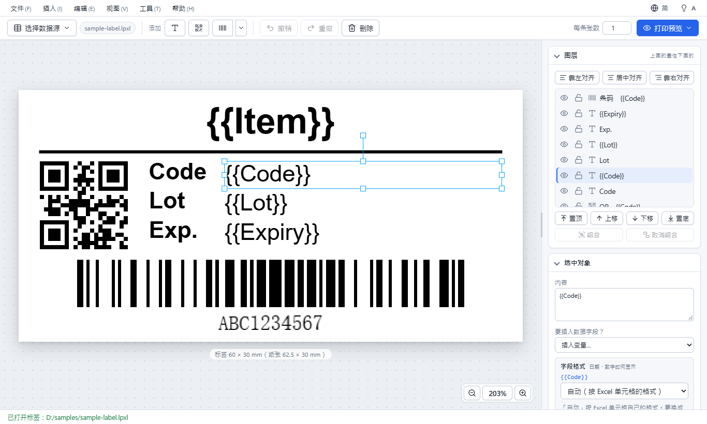
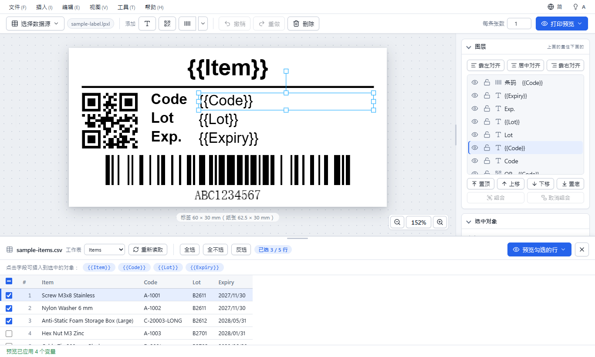
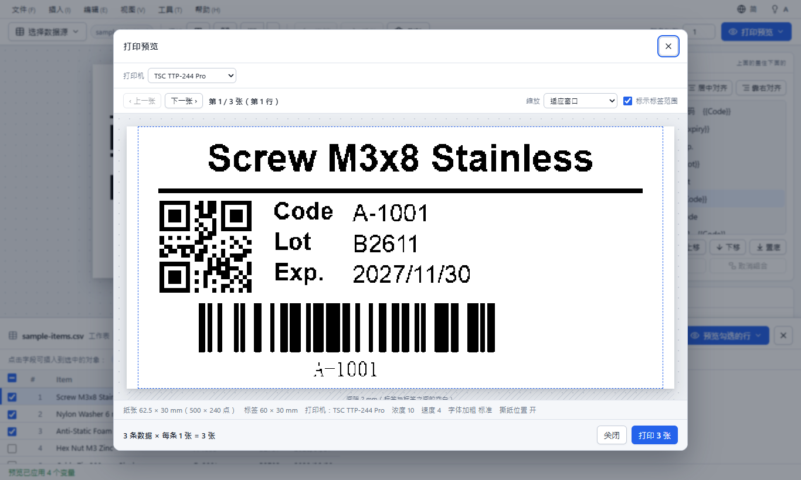
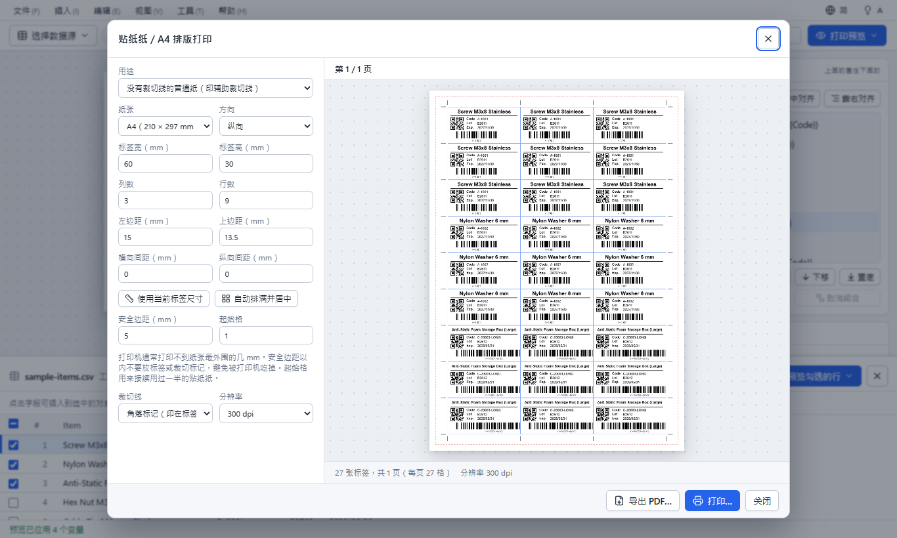
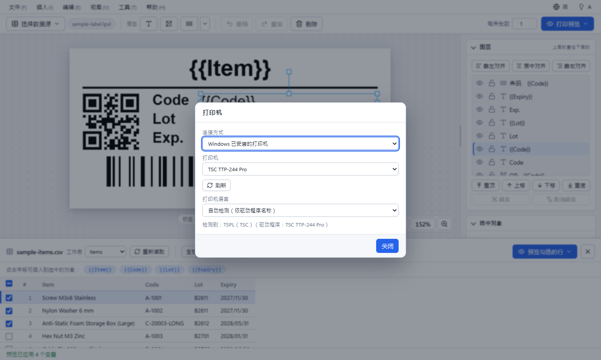

# Label Printer

[English](README.md) · [繁體中文](README.zh-TW.md) · **简体中文** · [Español](README.es.md) · [Deutsch](README.de.md) · [日本語](README.ja.md) · [한국어](README.ko.md)

<p align="center"></p>

开源、免费、轻量的 Windows 标签设计与打印软件。排好一张标签、连接数据源（Excel、CSV、SQLite、Access，以及可通过 ODBC 连接的数据库），就能一次打印出几百张内容各不相同的标签。支持 TSPL、ZPL、EPL2、CPCL、DPL、SBPL 等指令语言的标签机（例如 TSC TTP-244 Pro；TSPL 以外为实验性质）。

**Windows 10／11 · 开源（MIT）· 完全免费 · 安装包约 5 MB**

## 为什么选 Label Printer

<table>
<tr>
<td valign="top" width="50%"><b>轻巧，打开就能用</b><br>安装包只有约 5 MB，不需要数据库服务器、不需要注册账号、不需要联网，也不必先学会一套复杂的设计软件。</td>
<td valign="top" width="50%"><b>设计、数据、打印在同一个界面</b><br>排好一张标签，选一份 Excel 或数据库，勾选要打印的行，按下打印。会用 Word 和 Excel 的人，几分钟就能上手。</td>
</tr>
<tr>
<td valign="top" width="50%"><b>真正的免费与开放</b><br>源代码以 MIT 许可证公开；没有广告、没有授权码、没有张数限制，也不会把你的标签上传到任何地方。</td>
<td valign="top" width="50%"><b>接得上常见的标签机</b><br>TSC（TSPL）是主要使用的路径，也支持 ZPL、EPL2、CPCL、DPL、SBPL（TSPL 以外为实验性质）；普通打印机还能改用 A4 贴纸纸排版。</td>
</tr>
</table>

## 可以做什么

-  **所见即所得的标签设计**：文字、二维码、条码、线条、矩形和图片，可拖动、缩放、对齐、编组，也能撤销。
-  **直接用 Excel／CSV 打印**：在标签上放 `{{Item}}`、`{{Lot}}`……勾选的每一行数据就打印成一张标签。
-  **打印之前先看清楚**：打印预览显示实际发送给打印机的黑白图像，可逐张翻看。
-  **太长的文字自动缩小**：设置固定范围后，品名太长时字号会自动缩小，不会被截掉。
-  **打印效果可以微调**：浓度、速度、撕纸位置，还有带 mm 刻度的校准标签，可以把位置修正到毫米。
-  **七种语言**：简体中文、繁體中文、English、Español、Deutsch、日本語、한국어，并有浅色和深色外观。

## 适合用在

- **仓储与发货**：序列号、批号、有效日期，一次打印出整批内容各不相同的标签。
- **设备与资产管理**：每台设备一张标签，带上编号与二维码，扫一下就能对照资料。
- **实验室与生产线**：试管、物料与半成品的条码标示，字段直接来自现有的 Excel 或数据库。
- **A4 贴纸纸与信封条**：在 A4 上排出多列多行的标签，需要时打印裁切辅助线，并避开打印机打不到的边缘。

## 界面一览

<sub>点一下缩略图可以查看大图。</sub>

<table>
<tr>
<td align="center" width="50%"><a href="docs/images/zh-CN/data.png"></a><br><sub>选择数据源（Excel 或 CSV），勾选要打印的行；点击字段名称就能插入到选中的对象。</sub></td>
<td align="center" width="50%"><a href="docs/images/zh-CN/preview.png"></a><br><sub>打印预览：逐张显示打印机实际会打印出的样子。</sub></td>
</tr>
<tr>
<td align="center" width="50%"><a href="docs/images/zh-CN/sheet.png"></a><br><sub>贴纸纸／A4 排版：设置纸张、列数行数、边距与裁切线，右边预览整页（红色虚线是安全边距）。</sub></td>
<td align="center" width="50%"><a href="docs/images/zh-CN/printer.png"></a><br><sub>在“打印机”设置中选择连接方式与打印机语言。从 Windows 选择打印机时会依驱动程序自动检测语言。</sub></td>
</tr>
</table>

## 下载与安装

打开 [Releases 页面](https://github.com/mixneko/Label-Printer/releases/latest)，下载其中一个文件：
- **`…_x64-setup.exe`**（推荐）：安装程序。安装在当前用户下，不需要管理员权限；在文件资源管理器中双击 `.lpxl` 标签文件就会用本程序打开，也可以在程序内自动更新。
- **`…_x64-portable.exe`**：免安装版，复制到任何位置即可运行；无法在程序内原地更新（会改为打开下载页面）。

需要 64 位的 Windows 10 或 11。如果电脑还没有 WebView2，安装程序会一并安装。

>  程序目前还没有做代码签名，第一次运行时 Windows 可能会出现蓝色的“Windows 已保护你的电脑”提示，请点击 **更多信息 → 仍要运行**。

## 快速上手

1. **选择打印机。** 第一次启动时会弹出“首次设置”，请选择用来打印标签的打印机（程序不会替你选，避免标签误打到办公打印机）。之后想更换，打开 **工具 → 打印机…**。如果选的是一般打印机（办公打印机、PDF），“打印预览”会直接改成 A4／贴纸纸排版。
2. **设置纸张。** 打开 **工具 → 纸张与标签尺寸…**，填入纸张和标签的尺寸（mm）。
3. **设计标签。** 用 **插入** 菜单或工具栏添加文字、二维码、条码等，拖动到想要的位置。要使用清单里的数据，在文字中输入 `{{Item}}`（两层大括号夹着字段名称）。
4. **选择数据源。** 点击 **选择数据源**，选择一个 Excel 或 CSV 文件。第一行是字段名称，之后每一行是一条数据。
5. **勾选、预览、打印。** 勾选要打印的行，点 **预览勾选的行 → 预览标签打印**，确认样子后在预览窗口点打印。每一行要打印几张可以在 **每条张数** 中设置。

## 好用的小技巧

- **日期和数字与 Excel 里看到的一致。** 单元格格式是 `yyyy/mm/dd` 就打印成那样。想换格式，可以写成 `{{Expiry|yyyy-mm-dd}}`。
- **品名太长。** 选中文字对象，开启 **限制在固定范围内（最大范围）**，再选择 **自动缩小字号**；只有放不下时文字才会缩小。
- **一次选多个对象。** 按住 Ctrl 或 Shift 点击，或在空白处拖动框选；Ctrl+G 编组，Ctrl+Shift+G 取消编组。
- **对齐线。** 拖动时会出现粉红色的对齐线；按住 Alt 可以自由移动。
- **快捷键。** Ctrl+S 保存 · Ctrl+P 打印预览 · Ctrl+Z 撤销 · Ctrl+Y 重做 · Ctrl+A 全选。
- **外观与语言。** 灯泡按钮可以在自动／浅色／深色之间切换，地球按钮可以更换语言。

## 打印出来太淡，或者位置偏了？

- **太淡：** 先提高 **打印浓度**（预览画面不会变化，但实际打印会更深），再视情况降低速度。细线条不够明显时，提高 **字体加粗**，预览会立刻反映。
- **位置偏了：** 打开 **工具 → 打印质量与出纸…**，点击 **生成校准标签** 并打印一张。确认四边外框都完整，再根据 mm 刻度（0 是纸张边缘）读出偏移量，填入 **位置左右（mm）** 和 **位置上下（mm）**。打印结果太靠左就填正的左右值；太靠上就填正的上下值。

## 自动更新

安装版启动时会在后台向 GitHub 查询一次是否有新版本，只读取公开的版本信息，不会发送您的任何数据。有新版本时会弹出窗口，点击 **立即更新** 就会在程序内下载、验证签名、安装并自动重新打开。可以在 **帮助 → 启动时自动检查更新** 中关闭启动时的检查，也可以随时用 **帮助 → 检查新版本** 手动检查。

## 示例文件

`samples/` 文件夹里附有可以直接试用的示例：`sample-label.lpxl`（60×30 mm 货品标签，含二维码、条码和日期），搭配 `sample-items.csv`、`sample-items.xlsx`（字段 Item、Code、Lot、Expiry）。先打开标签，再选择其中一个数据文件。`sample-items-big5.csv` 是同一份清单，使用台湾版 Excel 另存 CSV 时的 Big5 编码，程序会自动识别 UTF-8 和 Big5。

## 直接读取网页版 Excel

放在云端的电子表格可以直接拿来打印，不必等同步到电脑，也不必向 Microsoft 注册任何应用程序。

- 点 **“选择数据源”→“网页版 Excel…”**，粘贴表格网址，在弹出的窗口登录一次账户，数据就出现在下方数据表。
- 云端内容改了，数据表会自己更新（默认每 30 秒，可调整或关闭）。预览与打印前会再取一次；勾选的行如果有变动或移位，会先停下来让你确认。
- 只读取，不会修改你的文件。程序不会经手你的密码；登录状态留在这台电脑上，可以点“退出登录”清除。
- 目前以 SharePoint 上的表格实际使用过（建议粘贴浏览器地址栏的网址）；OneDrive 与个人账户为实验性质。公司若禁止下载文件，就无法使用。

## 连接数据库（SQLite、Access、ODBC）

除了 Excel 和 CSV，也可以把数据库当数据源：点 **“选择数据源”→“连接到数据库…”**，或在“选择数据源”里直接选 SQLite／Access 文件（`.db`、`.sqlite`、`.mdb`、`.accdb`）。加载后的用法和 Excel 一样：勾选数据行、预览、打印，数据表可以在下拉菜单中切换。

- **SQLite**：选择文件就能用，已用实际的 SQLite 文件测试。
- **Access**：电脑上要有“Microsoft Access Driver (*.mdb, *.accdb)”（安装 Microsoft Office 或免费的 Access Database Engine 时会一并装上，位数要和本程序相同，也就是 64 位）。尚未用真正的 Access 文件验证，标示为实验性质。
- **SQL Server、MySQL／MariaDB、PostgreSQL**：程序内置连接功能，**不需要安装任何驱动程序**。在对话框选数据库类型，填服务器、数据库名称、账号密码（SQL Server 也可用 Windows 身份验证）就能连接，不必懂连接字符串；默认加密并验证服务器证书，内网的自签证书可在“连接安全性”改成信任，建议使用只有读取权限的账号。MySQL／MariaDB 与 PostgreSQL 已用 MariaDB 11.8、PostgreSQL 18 实测（含加密连接）；SQL Server 尚未用实际服务器验证，标示为实验性质。其他数据库与 Access 仍走 ODBC，需要先安装驱动程序（选“其他 ODBC”输入连接字符串）。
- 一律**只读**，不会修改数据库；连接字符串里的密码只暂存在内存中，不会保存。可以另外填一个 SELECT 查询，只取需要的字段或筛选数据行。日期与数字字段也能用 `{{字段|yyyy/mm/dd}}` 指定格式。单次最多读取 100,000 行，更大的数据请用查询缩小范围。

## 其他标签机与 A4 贴纸纸（实验性质）

以下两项功能已经写好并通过自动测试，但**尚未在真实的打印机上验证**，所以标示为实验性质。如果你用了，欢迎反馈结果。

**其他标签机语言。** 除了默认的 TSPL（TSC），也可以选 ZPL II、EPL2、CPCL、DPL（Datamax-O'Neil）、SBPL（SATO）。从 Windows 选择打印机时，程序会依驱动程序的名称自动判断语言；猜不出来（程序不会替你猜）或用 Raw TCP 直连时，请自己选“打印机语言”（首次设置，或 **工具 → 打印机…**）。如果打印机不是标签机（办公打印机、PDF 等），选“一般打印机”，或让程序自动判断；之后“打印预览”会直接切换成 A4／贴纸纸排版。这些语言默认只发送点阵图；在条码或二维码的属性中勾选“使用打印机原生指令打印”，可以改用打印机自己的条码指令（勾选时会显示烧瓶图标的“实验中”提醒，欢迎反馈打印结果；EPL2 与 SBPL 没有二维码指令，仍用图形打印）。

**贴纸纸与 A4 排版。** 点 **“打印预览”→“贴纸纸／A4 排版预览…”**（数据表上的“预览勾选的行”也可以；选的是一般打印机时，点“打印预览”就直接进来），可以在 A4 或 Letter 上排出多列多行的标签：

- “有模切的贴纸纸”不印裁切线；“没有裁切线的普通纸”可以印角落标记或虚线格线，方便剪裁（例如信封条）。
- **安全边距**（默认 5 mm）：打印机通常打印不到纸张最外围，标签或裁切标记排到这个范围内时，预览会标红并提醒。“自动排满并居中”会自动避开这一圈。
- **起始格**可以接续用过一半的贴纸纸。可以导出 PDF，或经 Windows 的打印窗口直接打印（缩放请选“100%／实际大小”，边距选“无”）。

## 常见问题

**打印机不在列表里。**  
请先在 Windows 中安装打印机（设置 → 打印机和扫描仪），再打开 **工具 → 打印机…** 刷新列表。

**换一台电脑后字体看起来不一样。**  
标签使用的是 Windows 已安装的字体，请在另一台电脑上安装相同的字体。

**我的数据会被发送到哪里吗？**  
不会把您的数据传给任何人。程序只在这些时候联网：检查更新（只询问 GitHub 有没有新版本），以及您自己使用“网页版 Excel”或连接数据库时（直接连到您指定的位置，只读取）。

**标签文件保存在哪里？**  
保存在您自己选择的位置，扩展名为 `.lpxl`。

## 授权

以 [MIT 许可证](LICENSE) 发布。所使用的第三方软件包的许可证，可在程序的 **帮助 → 第三方授权声明** 中查看。 界面图标取自 [Lucide](https://lucide.dev)（ISC 许可证）。

<details>
<summary><b>给开发者</b></summary>

技术栈：Tauri 2（Rust）+ TypeScript + Vite + Konva。标签在前端渲染，后端生成 TSPL、ZPL、EPL2、CPCL、DPL 或 SBPL 指令（依所选的打印机语言）并发送到打印机（Windows 打印队列 RAW，或 Raw TCP）。

```powershell
npm install
npm run tauri dev        # 开发模式
npm run dist             # 免安装 exe + NSIS 安装程序
npm run test:ui          # 界面测试（需要 Microsoft Edge）
cargo test --manifest-path src-tauri/Cargo.toml
```

需求：Node.js LTS、Rust（MSVC 工具链，含“使用 C++ 的桌面开发”工作负载）和 WebView2。

推送 `vX.Y.Z` 标签时由 GitHub Actions 构建并发布。流程需要仓库 Secret `TAURI_SIGNING_PRIVATE_KEY`（用 `tauri signer generate` 生成的更新签名私钥，公钥在 `src-tauri/tauri.conf.json`）；私钥丢失后就无法再向已安装的用户推送更新。

重新生成 xlsx／csv 示例：`cargo run --manifest-path src-tauri/Cargo.toml --example make_samples`；重新生成 README 截图：`node scripts/make-readme-shots.mjs`。

</details>
